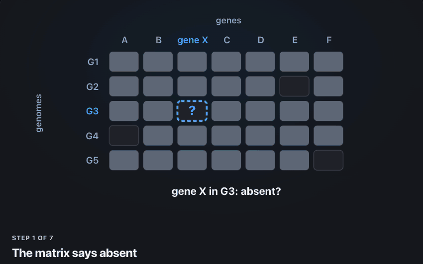

<div align="center">
  <picture>
    <source media="(prefers-color-scheme: dark)" srcset="assets/recore_logo_dark.svg">
    
  </picture>

### Missing from the matrix. Still in the genome.

Recore searches every empty cell of a pangenome matrix in the assemblies,<br>
puts back the genes that are really there, and keeps the evidence for each one.

<a href="https://pathogenomics-lab.github.io/recore/"></a>

[Install](https://pathogenomics-lab.github.io/recore/#start) ·
[Your command](https://pathogenomics-lab.github.io/recore/#command) ·
[Try it](https://pathogenomics-lab.github.io/recore/#try) ·
[How it works](https://pathogenomics-lab.github.io/recore/how-it-works.html) ·
[Docs](https://pathogenomics-lab.github.io/recore/documentation.html) ·
[Reference](https://pathogenomics-lab.github.io/recore/reference.html)

<sub>For Panaroo, Roary, PPanGGOLiN, PanTA and PIRATE · pure Rust · Linux and macOS</sub>

<a href="https://github.com/PathoGenOmics-Lab/recore/actions/workflows/ci.yml"></a>
<a href="LICENSE"></a>

<a href="https://doi.org/10.5281/zenodo.23448590"></a>

</div>

__Paula Ruiz-Rodriguez<sup>1</sup>__
__and Mireia Coscolla<sup>1</sup>__
<br>
<sub> 1. I<sup>2</sup>SysBio, University of Valencia-CSIC, FISABIO Joint Research Unit Infection and Public Health, Valencia, Spain </sub>

<p align="center">
  <picture>
    <source media="(prefers-color-scheme: dark)" srcset="assets/how-it-works_dark.gif">
    
  </picture><br>
  <sub>One empty cell, seven steps. <a href="https://pathogenomics-lab.github.io/recore/how-it-works.html">The interactive version</a> lets you pick what the search finds.</sub>
</p>

## 1 · Install

Two commands. Recore uses [minimap2](https://github.com/lh3/minimap2) to search.

```bash
conda install -c bioconda minimap2     # or: brew install minimap2 / sudo apt install minimap2
cargo install --git https://github.com/PathoGenOmics-Lab/recore --locked
```

Needs Rust 1.85 or newer ([rustup.rs](https://rustup.rs)), about a minute to
build. Check with `recore --version`. From a clone, `cargo build --release`
puts the binary at `target/release/recore`.

## 2 · Your command

Give it what your pangenome tool wrote and one assembly per genome, named like
the matrix columns.

```bash
recore \
  -p gene_presence_absence.csv \
  -r pan_genome_reference.fa \
  -g genomes/ \
  -a annotations/ --synteny \
  --write-html-report \
  -t 8 -o recore_output/
```

That is Panaroo with GFF files.
[The website writes it for your tool and the files you have](https://pathogenomics-lab.github.io/recore/#command),
and [Inputs](docs/getting-started/inputs.md) says how the names have to match.

## 3 · Or try it first

Twelve genomes with eleven false absences planted in them. About a minute.

```bash
curl -sO https://raw.githubusercontent.com/PathoGenOmics-Lab/recore/main/benchmarks/make_tutorial_dataset.py
python3 make_tutorial_dataset.py --out tutorial_data
recore -p tutorial_data/gene_presence_absence.csv \
       -r tutorial_data/pan_genome_reference.fa \
       -g tutorial_data/genomes -a tutorial_data/annotations --synteny \
       --tree tutorial_data/species.tree --write-html-report -o tutorial_out
```

`tutorial_out/summary.txt` should read:

```text
Rescued:               11   every planted absence found
Matrix-corrected:      8    the other 3 are pseudogenes: kept out, with the reason
```

Then open `tutorial_out/recore_report.html`. The
[tutorial](docs/getting-started/tutorial.md) tells the story behind each number.

## 4 · What you get

Four files answer most questions. [All of them](docs/guide/outputs.md).

| File | What it is |
|---|---|
| `gene_presence_absence_recore.csv` | The corrected matrix, in the input's format (and as `.Rtab`). Feed it to your next tool. |
| `gene_presence_absence_recore_states.csv` | The same matrix with a state in every cell: input, put back, kept out and why. For figures. |
| `orthology_evidence.tsv` | One row per change: the evidence, the decision, and wording you can use in a paper. |
| `recore_report.html` | The whole run in one page that works offline. Open it in any browser. |

[Explore an example report](https://pathogenomics-lab.github.io/recore/#report),
the one the example run writes from synthetic data.

## 5 · One setting that matters

`--matrix-policy` picks which evidence reaches the corrected matrix. All of it
stays in the audit files.

| Policy | What reaches the corrected matrix |
|---|---|
| `strict` | Only genes tied to the same locus by the annotation or by their neighbours. Fewest changes. |
| `balanced` (default) | Adds full-length genes found by sequence. Pseudogenes and partial copies stay out. **Use it for papers.** |
| `sensitive` | Also puts back partial and disrupted copies that pass the quality guard. For exploring. |

[Matrix policies](docs/guide/matrix-policies.md) has the rules and the quality
guard.

## If something looks off

[The first questions people ask](https://pathogenomics-lab.github.io/recore/#faq)
are answered on the website. Still stuck? Ask in
[Discussions](https://github.com/PathoGenOmics-Lab/recore/discussions);
[Issues](https://github.com/PathoGenOmics-Lab/recore/issues) are for crashes and
plainly wrong results.

## Learn more

The website is plain HTML in [`docs/`](docs/), so it also opens from a clone,
offline: open `docs/index.html`. Every page of its Docs tab is a markdown file
here as well:

- **Start:** [Tutorial](docs/getting-started/tutorial.md) · [Inputs](docs/getting-started/inputs.md)
- **Guide:** [Parameters](docs/guide/parameters.md) · [Matrix policies](docs/guide/matrix-policies.md) · [Output files](docs/guide/outputs.md) · [Run report](docs/guide/report.md)
- **How it works:** [Algorithm](docs/how-it-works/algorithm.md) · [Evidence states](docs/how-it-works/evidence-states.md) · [Rescue types](docs/how-it-works/rescue-types.md) · [Evolutionary events](docs/how-it-works/evolutionary-events.md) · [Limits and comparisons](docs/how-it-works/limits.md)
- **Project:** [Changelog](CHANGELOG.md) · [Benchmarks](benchmarks/README.md) · [Contributing](.github/CONTRIBUTING.md), with the tests and the checks CI runs

## Cite

> Ruiz-Rodriguez P, Coscolla M. (2026). Recore: post-hoc rescue and quality
> control of pangenome presence/absence matrices. *In preparation.*

The software itself is archived on Zenodo: [doi:10.5281/zenodo.23448590](https://doi.org/10.5281/zenodo.23448590)
for every version, or [doi:10.5281/zenodo.23448591](https://doi.org/10.5281/zenodo.23448591) for 1.0.0.

<sub>AGPL-3.0, see [LICENSE](LICENSE) · [PathoGenOmics Lab](https://github.com/PathoGenOmics-Lab) · Paula Ruiz-Rodriguez, paula.ruiz.rodriguez@csic.es</sub>

---

<h2 id="contributors" align="center">

✨ [Contributors](https://github.com/PathoGenOmics-Lab/recore/graphs/contributors)
</h2>

<!-- ALL-CONTRIBUTORS-LIST:START - Do not remove or modify this section -->
<!-- prettier-ignore-start -->
<!-- markdownlint-disable -->
<div align="center">
Recore is developed with ❤️ by:
<table>
  <tr>
    <td align="center">
      <a href="https://github.com/paururo">
        
        <br />
        <sub><b>Paula Ruiz-Rodriguez</b></sub>
      </a>
      <br />
      <a href="" title="Code">💻</a>
      <a href="" title="Research">🔬</a>
      <a href="" title="Ideas">🤔</a>
      <a href="" title="Data">🔣</a>
      <a href="" title="Design">🎨</a>
      <a href="" title="Tool">🔧</a>
    </td>
    <td align="center">
      <a href="https://github.com/mireiacoscolla">
        
        <br />
        <sub><b>Mireia Coscolla</b></sub>
      </a>
      <br />
      <a href="https://www.uv.es/instituto-biologia-integrativa-sistemas-i2sysbio/es/investigacion/proyectos/proyectos-actuales/mol-tb-host-1286169137294/ProjecteInves.html?id=1286289780236" title="Funding/Grant Finders">🔍</a>
      <a href="" title="Ideas">🤔</a>
      <a href="" title="Mentoring">🧑‍🏫</a>
      <a href="" title="Research">🔬</a>
      <a href="" title="User Testing">📓</a>
    </td>
  </tr>
</table>

This project follows the [all-contributors](https://github.com/all-contributors/all-contributors) specification ([emoji key](https://allcontributors.org/docs/en/emoji-key)).
</div>
<!-- markdownlint-restore -->
<!-- prettier-ignore-end -->
<!-- ALL-CONTRIBUTORS-LIST:END -->
