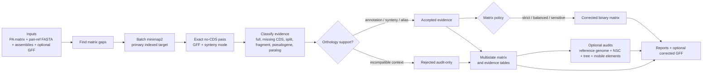

<div align="center">
  
  <h1>Recore</h1>
  <p><strong>Post-hoc rescue, audit, and quality control of pangenome presence/absence matrices.</strong></p>

  <p>
    <a href="https://github.com/PathoGenOmics-Lab/recore/actions/workflows/ci.yml"></a>
    <a href="LICENSE"></a>
    
  </p>
</div>

Pangenome pipelines can mark a gene as absent even when the sequence is still
present in the assembly. These false absences inflate the accessory genome,
shrink the core genome, and create noisy lineage-specific signals.

Recore searches each absent gene against the genome assemblies with minimap2,
classifies the evidence, validates orthology when annotations/synteny are
available, and writes both:

- a **Panaroo-compatible corrected binary matrix** for downstream analyses
- a **multistate evidence matrix** for audit, plotting, and manuscript review

The central design choice is conservative: Recore separates **sequence evidence**
from **clean binary presence**. Full-length evidence can be corrected in the
binary matrix, while partial homology, pseudogenes, paralog traps, and
incompatible-context hits remain visible in audit outputs instead of silently
becoming presence calls.

## Table of Contents

- [Quick Start](#quick-start)
- [Current Audit Guarantees](#current-audit-guarantees)
- [Which Matrix Policy Should I Use?](#which-matrix-policy-should-i-use)
- [How It Works](#how-it-works)
- [Benchmark](#benchmark)
- [Inputs](#inputs)
- [Installation](#installation)
- [Usage Profiles](#usage-profiles)
- [Output Files](#output-files)
- [Evidence States](#evidence-states)
- [Rescue Types](#rescue-types)
- [Algorithm Notes](#algorithm-notes)
- [Evolutionary Event Interpretation](#evolutionary-event-interpretation)
- [Comparison With Panaroo Refinding](#comparison-with-panaroo-refinding)
- [What Recore Does Not Claim](#what-recore-does-not-claim)
- [Documentation](#documentation)
- [Changelog](#changelog)
- [Citation](#citation)

## Quick Start

Use this for a publication-grade correction pass when FASTA assemblies and GFF
annotations are available:

```bash
recore \
  -p gene_presence_absence.csv \
  -r pan_genome_reference.fa \
  -g genomes/ \
  -a annotations/ \
  --synteny \
  --multi-allele \
  --nscluster \
  --nsc-engine mmseqs2 \
  --nsc-min-seq-id 0.9 \
  --nsc-coverage 0.8 \
  --preset asm5 \
  --min-prevalence 0.05 \
  --matrix-policy balanced \
  --reference-genome AS00146 \
  --write-html-report \
  -t 8 \
  -o recore_output/
```

Most users should start with:

- `--matrix-policy balanced` for the corrected binary matrix
- `gene_presence_absence_recore_states.csv` for audit and figures
- `orthology_evidence.tsv` for publication wording and manual review
- `recore_report.html` from `--write-html-report` for a self-contained run
  summary with headline QC, mechanisms, and top candidate clusters
- `reference_genome_audit.tsv` when asking whether clusters are truly absent
  from a reference genome
- `reference_cluster_events.tsv` to flag reference-absent clusters that look
  like event-derived alleles/fragments of a reference gene
- `evolutionary_events.tsv` to interpret each cluster as an acquisition,
  loss, IS interruption, pseudogene, paralog/duplication, reference-derived
  allele, context shift, or unresolved accessory signal. When `--nscluster`
  is enabled, this table also marks both redundant NSC members and the
  representative cluster that receives the merged presence support.

## Current Audit Guarantees

The current development branch writes output schema `recore.outputs.v6`. In
addition to the corrected matrix, every run now records:

- early input failures for empty matrices, empty pan-reference FASTA files, and
  duplicate genome or cluster names, before expensive searches start;
- GFF3 percent-decoded identifiers/aliases/products before gene matching, so
  encoded locus tags do not silently miss their matrix entries;
- multicopy-aware recomputation of `No. isolates`, `No. sequences`, and
  `Avg sequences per isolate` in the corrected Panaroo-compatible matrix;
- `genome_qc.tsv` with FASTA/GFF availability, contig remapping, rescue burden,
  correction burden, synteny rejections, and paralog rejections per genome;
- cluster components linking split, annotation-matched, nucleotide-redundant,
  and paralog-related clusters for manual review;
- tree-derived root-state confidence, carrier-MRCA size/purity, and Dollo-like
  origin/loss metrics when `--tree` is supplied.

## Which Matrix Policy Should I Use?

Recore always records detected evidence in audit files. The matrix policy only
controls which accepted evidence is inserted into the **binary** corrected
matrix.

| Goal | Recommended policy | What it corrects | What stays audit-only |
|------|--------------------|------------------|------------------------|
| Paper-ready binary PA matrix | `balanced` | strict same-locus calls, alias clusters, and full-length sequence evidence | pseudogenes, partial homology, context-rejected hits |
| Maximum conservatism | `strict` | only strict same-locus and alias-cluster evidence | full sequence-only hits without annotation/synteny support |
| Exploratory rescue | `sensitive` | accepted strict, alias, sequence-only, partial, and pseudogene evidence that passes the quality guard | rejected contexts, weak accepted evidence, and homologous/paralogous traps |

Recommended wording:

> We used Recore with the balanced matrix policy, which rescues full-length false
> absences while retaining partial or disrupted homologues as multistate
> audit-only evidence.

## How It Works



Key idea: the corrected binary matrix is not the only output. Recore also
keeps the evidence trail that explains why a cell was corrected, retained as
audit-only, or rejected.

Optional audit layers add biological interpretation without changing the core
correction rules:

- `--reference-genome` asks whether a cluster is truly absent from the chosen
  reference, or whether it looks like a reference-derived allele, fragment, or
  paralogous signal.
- `--tree` uses parsimony on the corrected state to describe lineage-specific
  gains, ancestral losses, recurrent/homoplastic signals, and retained core
  genes. Ambiguous Fitch root states are reported as ambiguous, not forced into
  a single ancestral story; carrier-MRCA purity and Dollo-like origin/loss
  metrics help separate compact clade-associated events from blinking patterns.
  If tree tips do not cover all matrix genomes, unmatched genomes are ignored
  and Recore reports an explicit warning.
- `--mobile-element-reference` aligns IS/transposase/mobile-element sequences
  near disrupted evidence so mobile-element support can be sequence-based, not
  dependent on product names in GFF annotations.
- `--nscluster` reports nucleotide-redundant clusters, marks redundant members,
  and marks the representative cluster that carries the merged support. NSC
  unions original matrix presence and matrix-corrected rescue evidence from
  redundant member clusters.

## Benchmark

Recore includes a synthetic benchmark that creates known false absences, true
absences, and partial pseudogenes, then computes precision/recall/F1 from the
actual corrected matrices.


Current synthetic benchmark:

| Policy | TP | FP | FN | Precision | Recall | F1 |
|--------|----|----|----|-----------|--------|----|
| `strict` | 0 | 0 | 5 | NA | 0.000 | 0.000 |
| `balanced` | 5 | 0 | 0 | 1.000 | 1.000 | 1.000 |
| `sensitive` | 5 | 0 | 0 | 1.000 | 1.000 | 1.000 |

Interpretation:

- `strict` is conservative in annotation-free settings.
- `balanced` recovers full-length false absences without converting partial
  pseudogenes into binary presence.
- `sensitive` allows partial/disrupted evidence at the policy layer, but the
  adaptive quality guard still blocks weak pseudogene-like evidence in this
  benchmark.
- No policy converts a homologous/paralogous trap into binary presence unless
  the evidence has already been promoted to same-locus support by synteny.

Reproduce:

```bash
python3 benchmarks/synthetic_benchmark.py
```

If `minimap2` is outside `PATH`:

```bash
python3 benchmarks/synthetic_benchmark.py --minimap2 /path/to/minimap2
```

The biological event benchmark adds a small GFF/synteny truth set. It checks
that a same-locus missing CDS is rescued, an identical paralog in the wrong
context is rejected, and the evolutionary audit table contains quantitative
synteny, ORF, phylogenetic-reliability, and paralog-risk columns.

```bash
python3 benchmarks/biological_event_benchmark.py
```

The synthetic benchmark validates policy behavior on matrix ground truth; the
biological benchmark validates the locus-context guardrails. Neither is a
species-specific biological truth benchmark.

## Inputs

| Input | Required | Description |
|-------|----------|-------------|
| `gene_presence_absence.csv` | yes | Panaroo-style matrix with metadata columns followed by genome columns |
| `pan_genome_reference.fa` | yes | Cluster representative sequences; FASTA IDs must match matrix cluster names |
| genome FASTAs | yes | One assembly per matrix genome column |
| GFF annotations | optional, recommended | Enables annotation-aware SPLIT, START_VARIANT, PARALOG, pseudogene, and synteny classification |
| reference genome name | optional | Used by `--reference-genome` to audit whether clusters are absent from a chosen reference |

Input checklist:

- Matrix genome columns should match FASTA/GFF file stems, or contain the same
  embedded `ASxxxxx` identifier.
- Pan-reference FASTA cluster names must match the `Gene` column.
- Empty matrices, empty pan-reference FASTA files, and duplicate genome or
  cluster names are rejected before the pipeline starts.
- GFF3 attributes are percent-decoded before matching `ID`, `Name`, `gene`,
  `locus_tag`, aliases, products, and notes to matrix gene IDs.
- Use GFFs whenever possible; without GFFs, Recore can still detect full-length
  sequence evidence and some partial/deletion evidence, but it cannot reliably
  distinguish SPLIT, START_VARIANT, and PARALOG by annotation overlap.
- Use `--synteny` with GFFs when paralogy or multi-locus clusters are plausible.
- Use `--multi-allele` when clusters have divergent alleles.
- Use `--min-prevalence 0.0` for exhaustive audits and a higher value such as
  `0.05` to reduce rare-cluster noise in large publication runs.

## Installation

### From Source

```bash
git clone https://github.com/PathoGenOmics-Lab/recore.git
cd recore
cargo build --release
```

Binary:

```bash
target/release/recore
```

Requirements:

- Rust 1.70 or newer
- [minimap2](https://github.com/lh3/minimap2) in `PATH`

Optional:

- [MMseqs2](https://github.com/soedinglab/MMseqs2) for alignment-based
  nucleotide similarity clustering with `--nsc-engine mmseqs2`

### Pre-Built Binaries

Tagged releases build Linux and macOS binaries through GitHub Actions. See
[Releases](https://github.com/PathoGenOmics-Lab/recore/releases).

## Usage Profiles

### Full Publication Run

```bash
recore \
  -p gene_presence_absence.csv \
  -r pan_genome_reference.fa \
  -g genomes/ \
  -a annotations/ \
  --synteny \
  --multi-allele \
  --nscluster \
  --nsc-engine mmseqs2 \
  --matrix-policy balanced \
  --reference-genome AS00146 \
  -t 8 \
  -o recore_output/
```

### Evolutionary and Mobile-Element Audit

```bash
recore \
  -p gene_presence_absence.csv \
  -r pan_genome_reference.fa \
  -g genomes/ \
  -a annotations/ \
  --synteny \
  --multi-allele \
  --nscluster \
  --matrix-policy balanced \
  --reference-genome AS00146 \
  --tree species.tree \
  --mobile-element-reference mobile_elements.fa \
  --mobile-element-min-identity 90 \
  --mobile-element-min-coverage 70 \
  --mobile-element-window 500 \
  -t 8 \
  -o recore_evolutionary_audit/
```

Use this when the main question is not only "is the gene present?" but "what
kind of event best explains the signal?". The output table
`evolutionary_events.tsv` keeps matrix correction, phylogenetic pattern,
reference similarity, local context, NSC redundancy, and nearby mobile-element
support in one row per cluster.

### Lightweight Rescue Without GFFs

```bash
recore \
  -p gene_presence_absence.csv \
  -r pan_genome_reference.fa \
  -g genomes/ \
  --matrix-policy balanced \
  -t 8 \
  -o recore_output/
```

Use this when annotations are unavailable. It can still rescue full-length
sequence evidence, but annotation-specific classifications are limited.

### Exhaustive Reference Audit

```bash
recore \
  -p gene_presence_absence.csv \
  -r pan_genome_reference.fa \
  -g genomes/ \
  -a annotations/ \
  --synteny \
  --multi-allele \
  --reference-genome AS00146 \
  --min-prevalence 0.0 \
  --matrix-policy balanced \
  -t 8 \
  -o recore_reference_audit/
```

Use this to classify whether clusters are genuinely absent from a reference
background, reference-like, partial, alias-like, paralogous, or already present.

### Built-In NSC Engine

If MMseqs2 is not installed, omit the engine flag and use the built-in MinHash
engine:

```bash
recore \
  -p gene_presence_absence.csv \
  -r pan_genome_reference.fa \
  -g genomes/ \
  --nscluster \
  --nsc-engine minhash \
  -o recore_output/
```

## Output Files

```
recore_output/
├── gene_presence_absence_recore.csv        # corrected Panaroo-compatible binary matrix
├── gene_presence_absence_recore_states.csv # multistate evidence matrix
├── rescue_report.tsv                       # accepted rescue events
├── orthology_evidence.tsv                  # accepted/rejected evidence with wording guidance
├── reference_genome_audit.tsv              # reference-specific audit when --reference-genome is set
├── reference_cluster_events.tsv            # event-derived reference-gene variants, audit-only
├── evolutionary_events.tsv                 # evolutionary pattern and mechanism audit
├── synteny_rejected_report.tsv             # explicit synteny FAIL candidates
├── paralog_rejected_report.tsv             # PARALOG candidates lacking synteny support
├── cluster_locus_context.tsv               # per-cluster locus-context rows when GFFs are loaded
├── cluster_locus_summary.tsv               # cluster-level context stability flags
├── cluster_synteny_blocks.tsv              # 5-neighbour synteny block audit
├── cluster_relationships.tsv               # SPLIT/PARALOG/annotation-match/NSC relationships
├── cluster_components.tsv                  # connected components of related clusters
├── cluster_component_members.tsv           # per-cluster component role and recommendation
├── genome_qc.tsv                           # per-genome rescue/annotation/QC burden
├── nscluster_report.tsv                    # NSC groups when --nscluster is enabled
├── corrected_gff/                          # optional GFF3 files with appended Recore CDSs
├── recore_report.html                      # optional self-contained run report
├── run_manifest.json                       # version, schema, parameters, inputs, and run counts
└── summary.txt                             # run summary
```

TSV outputs are written as single-line records. Tabs, line breaks, and null
characters inside annotation-derived text are normalized to spaces so GFF
products, notes, and aliases cannot corrupt downstream tables.
`run_manifest.json` records `tool_version`, `schema_version`, input paths,
parameters, and key counts so every output directory can be traced back to the
exact Recore configuration that produced it. Current output directories use
schema `recore.outputs.v6`.

For publication figures:

- Use `gene_presence_absence_recore.csv` for binary presence/absence analyses.
- Use `gene_presence_absence_recore_states.csv` when plotting uncertainty,
  pseudogenes, partial homology, or rejected contexts.
- Use `orthology_evidence.tsv` to justify whether a cluster is "present",
  "partial/disrupted", "possible paralog", or "not supported". It also reports
  adaptive sequence floors, an integrated orthology confidence score, and
  risk flags before a rescue is allowed into the binary matrix.
- Use `reference_genome_audit.tsv` to support claims such as "absent from
  H37Rv/reference" instead of relying only on the original matrix. The
  `publication_confidence` column flags clean absences separately from
  complex partial/paralogous or event-derived reference evidence. Weak
  accepted sequence-only hits that fail the adaptive quality guard remain
  `reference_like_ambiguous`.
- Use `reference_cluster_events.tsv` to keep clusters separate in the matrix
  while reporting whether their representative sequence is best explained as
  a short/long in-frame allele, full-length same-gene sequence, frameshift-like
  length change, or partial homology to a gene in the audited reference.
- Use `evolutionary_events.tsv` to separate phylogenetic pattern from molecular
  mechanism: ancestral retention/loss, clade-associated gain, homoplasy,
  IS-supported interruption, pseudogenization, duplication/paralogy,
  reference-derived alleles, NSC cluster redundancy, and context-shift
  candidates.

When an output directory is reused, Recore clears known optional reports before
writing the new run so stale `reference_*`, rejected-evidence, NSC, synteny, or
corrected-GFF files cannot be mistaken for current results.

Key columns in `evolutionary_events.tsv`:

| Column | Meaning |
|--------|---------|
| `phylogenetic_pattern` | parsimony pattern from the optional tree: retained, loss, gain, recurrent, homoplastic, singleton/noise, or not assessed |
| `phylogenetic_reliability` | high/moderate/low reliability label from tree pattern, root ambiguity, MRCA purity, and parsimony changes |
| `phylogenetic_blink_flag` | explicit low/moderate/high flag for repeated gain/loss or singleton-like blinking patterns |
| `penalized_phylo_model` / `penalized_phylo_score` | Dollo-like model using the smallest carrier MRCA; broad origins, many losses, root ambiguity, and repeated gains reduce the score |
| `dollo_origin_tips` / `dollo_origin_purity` | size and carrier purity of the inferred single-gain origin used by the Dollo-like model |
| `ancestral_state` / `root_state_confidence` | Fitch root state and whether the root state is unambiguous or ambiguous |
| `carrier_mrca_tips` / `carrier_mrca_purity` | size and carrier purity of the smallest clade containing all carriers |
| `molecular_mechanism` | conservative interpretation combining rescue evidence, reference audit, context stability, mobile-element evidence, and NSC status |
| `mechanism_detail` | compact reason for the mechanism call, including `nsc_representative` or `nsc_member_merged_into_representative` when relevant |
| `support_level` | confidence tier for wording, not a functional validation claim |
| `evolutionary_signal_score` / `highlight_priority` | integrated prioritization for manuscript review; blinking/paralog components are deprioritized |
| `cluster_component_*` | whether the cluster belongs to a split/paralog/NSC/annotation-linked component and how to review that component |
| `paralog_locus_risk` | cluster-level risk flag from locus context, synteny rejections, and paralog evidence |
| `synteny_mean_score` / `synteny_pass_fraction` | quantitative summary of local-context support across rescue evidence |
| `orf_integrity_summary` | counts of in-frame, out-of-frame, fragmented, or disrupted ORF signals |
| `mobile_element_source` | `sequence` when supported by `--mobile-element-reference`, `annotation` when supported by GFF labels |
| `target_reference_gene` | reference locus/gene when the cluster is best explained as reference-derived homology |
| `recommended_wording` | conservative wording for manuscripts and manual review |

## Evidence States

The multistate matrix uses the same shape as the original PA matrix but stores
biological states:

| State | Meaning | Binary correction under `balanced` |
|-------|---------|------------------------------------|
| `PRESENT_INPUT` | Present in the original matrix | already present |
| `ABSENT` | No accepted evidence found | no |
| `STRICT_PRESENT` | Same-locus evidence from annotation/synteny | yes |
| `ALIAS_CLUSTER` | Same biological locus assigned to another cluster | yes |
| `SEQUENCE_ONLY` | Full-length sequence evidence without stronger annotation context | yes |
| `MISSING_CDS_UNVALIDATED` | Full-length sequence falls in a locus with no CDS annotation but lacks synteny support | no |
| `PARTIAL_HOMOLOGY` | Partial homologous sequence | no |
| `PSEUDOGENE` | Disrupted gene evidence | no |
| `HOMOLOG_PARALOG` | Homologous/paralogous hit | no |
| `REJECTED_CONTEXT` | Candidate rejected by context/paralog checks | no |

## Rescue Types

| Type | Description | Typical interpretation |
|------|-------------|------------------------|
| `DROPPED` | Full-length gene sequence present but missing from matrix | false absence caused by graph cleaning or annotation transfer |
| `MISSING_CDS` | Full-length gene sequence present at a locus where the GFF has no substantial CDS overlap | annotation omission; corrected only when synteny validates the locus |
| `SPLIT` | Hit overlaps a CDS assigned to another cluster | cluster split or alias |
| `FRAGMENTED` | Gene reconstructed from multiple biological fragments | possible disrupted or split locus |
| `ALIGNMENT_SPLIT` | Multiple alignments reconstruct the gene without strong biological break evidence | alignment-level split, audit carefully |
| `START_VARIANT` | Same CDS with a shifted start | start-site/annotation disagreement |
| `PARALOG` | Similar locus but not clearly the same gene | not corrected unless synteny supports it |
| `PSEUDOGENE` | Internal stop, frameshift, or partial deletion | disrupted homologue, audit-only under `balanced` |

Pseudogene sub-types:

| Sub-type | Signal | Interpretation |
|----------|--------|----------------|
| `InternalStop` | in-frame premature stop codon | nonsense disruption |
| `Frameshift` | fragment gaps not divisible by 3 | indel disrupting the reading frame |
| `PartialDeletion` | high identity but 60-80% query coverage | truncated gene |

## Parameters

### Core Parameters

| Parameter | Default | Description |
|-----------|---------|-------------|
| `-p, --presence-absence` | required | Panaroo `gene_presence_absence.csv` |
| `-r, --pan-reference` | required | Panaroo `pan_genome_reference.fa` |
| `-g, --genomes` | required | directory of genome FASTA files |
| `-a, --annotations` | optional | directory of GFF/GFF3 annotations |
| `-o, --output` | `recore_output/` | output directory |
| `--min-identity` | `90.0` | minimum percent identity for a hit |
| `--min-coverage` | `80.0` | minimum query coverage for full rescue |
| `--preset` | `asm5` | minimap2 preset; use `asm20` for more divergent genomes |
| `--min-prevalence` | `0.1` | skip rescue for clusters below this prevalence |
| `--matrix-policy` | `balanced` | binary correction policy: `strict`, `balanced`, or `sensitive` |
| `--multi-allele` | off | query all alleles per cluster |
| `--synteny` | off | validate rescues by flanking gene context; requires GFFs |
| `--reference-genome` | optional | audit one reference/background genome |
| `--tree` | optional | rooted Newick tree for parsimony-based evolutionary event interpretation |
| `--mobile-element-reference` | optional | FASTA of mobile elements, IS, or transposase loci for name-agnostic sequence support near disrupted loci |
| `--mobile-element-min-identity` | `85.0` | minimum nucleotide identity for mobile-element reference hits |
| `--mobile-element-min-coverage` | `50.0` | minimum query coverage for mobile-element reference hits |
| `--mobile-element-window` | `1000` | maximum distance in bp from a rescue/disruption interval to report mobile-element support |
| `--write-corrected-gff` | off | write GFF3 files with appended rescued CDS features |
| `--write-html-report` | off | write a self-contained `recore_report.html` with headline QC, correction counts, mechanisms, and top candidate clusters |
| `-t, --threads` | `4` | number of threads |

### Nucleotide Similarity Clustering

| Parameter | Default | Description |
|-----------|---------|-------------|
| `--nscluster` | off | enable nucleotide similarity clustering |
| `--nsc-engine` | `minhash` | `minhash` built-in or `mmseqs2` alignment-based |
| `--nsc-kmer-size` | `21` | k-mer size for MinHash sketching |
| `--nsc-threshold` | `0.8` | max-containment threshold for MinHash merging |
| `--nsc-min-seq-id` | `0.9` | minimum identity for MMseqs2 clustering |
| `--nsc-coverage` | `0.8` | bidirectional coverage for MMseqs2 clustering |

## Algorithm Notes

### Batch Search

Recore avoids one minimap2 process per genome:

1. Write all required cluster sequences to one query FASTA.
2. Concatenate all target genomes with prefixed contig names
   (`genome|||contig`).
3. Build one minimap2 index.
4. Run one minimap2 alignment.
5. Stream and demultiplex PAF hits back to `(genome, cluster)` gaps.

This keeps large pangenome audits fast and memory-stable.

### Synteny Model

When `--synteny` is enabled, Recore compares flanking gene context around the
candidate rescue with contexts from genomes where the cluster is already
present. It tests adaptive windows from one to five upstream/downstream
neighbours, scores upstream and downstream sides separately, gives nearest
neighbours the highest weight, matches each reference neighbour at most once,
and keeps the smallest high-scoring passing window. If a reference genome has
multiple gene IDs for the cluster, all copies are evaluated rather than only
the first matrix entry. In large reference sets, recurrent support must come
from more than one genome, so duplicated copies inside a single genome cannot
validate a rescue by themselves.

The model uses recurrent compatible contexts, not one fragile exact string, so
minor annotation boundary differences do not create artificial failures.
Explicit incompatible contexts are rejected and written to audit tables, while
`rescue_report.tsv` and `orthology_evidence.tsv` expose the score, support
count, reference-context count, selected neighbour window, and upstream/downstream
matches.

### Nucleotide Similarity Clustering

`--nscluster` detects clusters that are distinct at the protein/annotation
level but nearly identical at the nucleotide level.

Two engines are available:

- **MinHash**: built-in, dependency-free, fast approximate clustering.
- **MMseqs2**: optional alignment-based clustering, recommended when exact
  nucleotide identity/coverage thresholds are needed.

NSC does not erase the audit trail. The binary matrix can receive merged
presence support through the representative cluster, including support derived
from Recore-corrected member clusters, while
`evolutionary_events.tsv`, `cluster_relationships.tsv`, and
`nscluster_report.tsv` keep the redundant members visible for review.

### Adaptive Orthology Guard

Matrix policy is not the only gate. Every accepted rescue is also scored by an
adaptive guard that combines sequence identity, query coverage, locus/synteny
evidence, ORF integrity, evidence state, cluster prevalence, and representative
sequence length. Rare clusters and very short clusters require stronger
sequence support because they are easier to over-call from weak homology.
Same-locus evidence such as a passing synteny context can override this stricter
sequence floor for `STRICT_PRESENT` or `ALIAS_CLUSTER` calls, but weak
sequence-only evidence is kept as `audit_only_quality`.

The guard is reported in `orthology_evidence.tsv` as
`adaptive_identity_floor`, `adaptive_coverage_floor`,
`adaptive_sequence_pass`, `orthology_confidence_score`,
`orthology_confidence_tier`, and `risk_flags`.

### Run Review Utilities

For a polished run summary, add `--write-html-report` to the Recore command.
This writes `recore_report.html` directly inside the output directory, with
headline matrix counts, QC bars, evolutionary mechanisms, top candidate
clusters, and links to the exact TSV files behind the summary. When `--tree`
is supplied and the tree/matrix is small enough for a browser, the same report
also embeds an interactive phylogeny plus corrected matrix explorer: choose or
click a gene cluster to recolor tree tips dynamically by input presence,
Recore rescue, NSC support, absence, or the evolutionary mechanism reported in
`evolutionary_events.tsv`. For MTBC-style genome names such as `L4_AS00146` or
`A4_AS00245`, tips can also be colored by lineage using the mycolorsTB Nature
palette. The explorer supports phylogram/cladogram switching, fullscreen review,
reference-absent filtering, mouse-wheel zoom on the tree and column header, a
Y-axis collapse slider for dense trees, and in-report legends explaining each
observed evolutionary process. Clicking evolutionary-mechanism cards adds or
removes those mechanisms from the matrix-column filter, and the selected-cluster
panel reports the reference gene/cell or reference-derived event source when
Recore can identify one. When `cluster_synteny_blocks.tsv` is available, the
viewer also opens a split panel showing the top unique five-neighbour synteny
blocks for the selected gene cluster, with the focal cluster highlighted and
shared neighbouring clusters connected between adjacent block rows. The synteny
panel can be hidden from the viewer controls when the tree plus matrix needs the
full available width.

Recore also includes lightweight Python utilities for reproducible review:

- `benchmarks/self_benchmark.py`: masks known-present cells, reruns Recore, and
  estimates dataset-specific masked-positive recall plus score calibration bins.
- `benchmarks/compare_runs.py`: compares two Recore output directories and
  labels unchanged, new, lost, and changed matrix calls.
- `benchmarks/recore_report.py`: creates a compact Markdown/HTML report for
  existing output directories that were generated without `--write-html-report`.

## Evolutionary Event Interpretation

`evolutionary_events.tsv` is an interpretation layer, not a new correction
policy. Its job is to answer a different question from the corrected matrix:

- The corrected matrix asks: **is there enough evidence to mark this cluster as
  present in this genome?**
- The evolutionary audit asks: **what biological or technical process best
  explains the cluster-level pattern after correction?**

The two answers are deliberately kept separate. A cluster can remain a real
matrix cluster while the recommended wording says "reference-gene derivative",
"paralog/duplication signal", "fragmented homology", or "review before claiming
novel acquisition".

### Evidence Used

Each `molecular_mechanism` call combines:

1. corrected cluster state after accepted rescues and optional NSC support;
2. reference-genome audit and reference-derived cluster events;
3. local locus-context stability and synteny/paralog rejection evidence;
4. optional tree parsimony, including explicit ambiguous-root reporting;
5. optional sequence-based mobile-element support;
6. connected components of related clusters, so paralogous, redundant, split,
   or annotation-linked clusters are interpreted together.

Tree tips are matched to matrix columns by exact name or embedded `ASxxxxx`
identifier. If only a subset of tips matches, evolutionary counts and patterns
are calculated on the matched subset and the run summary/log warns about the
incomplete match.

The tree is used for topology-based interpretation. Recore first scores the
corrected presence/absence pattern on the matched tree using binary parsimony
and a Dollo-like single-origin model. This produces fields such as
`phylogenetic_pattern`, `phylogenetic_blink_flag`,
`carrier_mrca_purity`, `dollo_origin_purity`, and
`penalized_phylo_score`. Branch lengths are preserved for the HTML viewer, but
the mechanism call itself is conservative and is driven primarily by evidence
type, locus context, and topology.

### Decision Order

The mechanism call is a deterministic evidence ladder. Direct molecular/locus
evidence has priority over a visually attractive tree pattern, because a clean
clade can still be caused by a reference allele, paralog collapse, gene
fragmentation, or annotation boundaries.

1. **Reference-derived event check**. If `reference_cluster_events.tsv` links
   the cluster to a gene in the audited reference, Recore first decides whether
   the cluster is a full-length/same-gene allele, a short/long in-frame allele,
   a frameshift/truncation/extension, or partial reference homology. If the same
   signal is also paralogous or multi-locus, it is treated as
   `duplication_or_paralog_expansion`.
2. **Mobile-element disruption check**. If a disrupted or fragmented rescue has
   nearby mobile-element evidence within the conservative window, Recore calls
   `IS_interruption_supported`. With `--mobile-element-reference`, this is
   sequence-based and name-agnostic; without it, Recore falls back to annotation
   labels such as insertion sequence, transposase, integrase, phage, or
   recombinase terms.
3. **ORF integrity check**. Pseudogene evidence is called
   `pseudogenization`; fragmented or split homology is called
   `gene_fragmentation_or_structural_break`.
4. **Paralog and locus-context check**. Explicit paralog evidence, unstable
   locus context, or multi-locus behaviour becomes
   `duplication_or_paralog_expansion`.
5. **Synteny rejection check**. Strong sequence similarity in an incompatible
   local context becomes `translocation_or_context_shift_candidate`, because it
   may represent a real sequence at the wrong locus, a translocation, or a
   paralog/annotation problem.
6. **Annotation/redundancy check**. Split genes, start-boundary shifts, or NSC
   representative/member relationships become
   `annotation_or_clustering_artifact`.
7. **Reference-absent clade check**. Only after the previous traps are ruled
   out, a cluster absent from the reference and concentrated in a lineage/clade
   can become `clean_insertion_or_acquisition_candidate`.
8. **Reference loss check**. If the reference is absent but the inferred root
   state is present, Recore prefers `reference_or_lineage_loss_candidate` over
   "gain everywhere else".
9. **Tree loss/homoplasy/retention check**. Ancestral or recurrent losses
   become `deletion_loss_candidate`; highly recurrent gain/loss patterns become
   `unstable_or_homoplastic_accessory_signal`; conserved ancestral presence
   becomes `ancestral_retained_no_disruption`.
10. **Fallback**. If the available matrix, reference, synteny, mobile-element,
    and tree evidence do not resolve the process, Recore reports
    `unresolved_accessory_variation`.

### Mechanism Meanings

| `molecular_mechanism` | When Recore assigns it | How to interpret it |
|-----------------------|------------------------|---------------------|
| `ancestral_retained_no_disruption` | The corrected cluster is broadly present and the tree pattern supports ancestral retention. | Conserved ancestral presence in the analysed set; not a novel acquisition. |
| `clean_insertion_or_acquisition_candidate` | The cluster is absent from the audited reference, present in a coherent lineage/clade, and lacks stronger reference/paralog/fragmentation/artifact explanations. | Best candidate for reference-absent accessory acquisition or insertion; validate flanks before claiming a novel locus. |
| `reference_or_lineage_loss_candidate` | The reference is absent, but the inferred root/background state is present. | More consistent with loss in the reference or reference lineage than independent gain in all other genomes. |
| `deletion_loss_candidate` | Tree pattern suggests ancestral presence with one or more losses. | Candidate deletion/loss event; inspect flanking genes, breakpoints, and mobile elements. |
| `IS_interruption_supported` | Fragmented/disrupted evidence is close to mobile-element evidence. | Candidate IS/transposase/mobile-element-mediated interruption; not automatically intact gene presence. |
| `pseudogenization` | Rescue evidence indicates frameshift, internal stop, or pseudogene-like disruption. | Homologous sequence exists, but should be described as disrupted unless additional evidence proves function. |
| `gene_fragmentation_or_structural_break` | Evidence is split, fragmented, or alignment-split. | Partial homology or local structural break; review before using as gain/loss evidence. |
| `duplication_or_paralog_expansion` | Paralog evidence, multi-locus context, or copy-number-like behaviour is detected. | Copy-number/paralog/cluster-definition complexity; avoid treating as one clean locus without manual locus review. |
| `reference_gene_allelic_derivative` | The cluster is best explained as same-gene, short in-frame, or long in-frame reference-derived sequence. | Event-derived allele/version of a reference gene; not a completely new gene. |
| `reference_gene_disruption_or_truncation` | Reference-like sequence has frameshift, truncation, or extension evidence. | Reference-gene-derived disrupted/truncated form; interpret with ORF integrity. |
| `partial_reference_homology` | The representative sequence partially matches a reference gene. | Some homology to reference exists; do not call "absent from reference" as if it were wholly novel. |
| `translocation_or_context_shift_candidate` | Sequence evidence exists but synteny/local context is incompatible. | Real sequence may be in a different context, translocated, paralogous, or annotation-driven; review locus manually. |
| `annotation_or_clustering_artifact` | Split/start-boundary evidence, NSC redundancy, or cluster-component evidence explains the signal. | Likely cluster definition, boundary, or redundancy issue rather than a biological gene gain/loss. |
| `unstable_or_homoplastic_accessory_signal` | The tree shows repeated appearances/disappearances or high blinking. | Could be real mobility/recombination, but also annotation/assembly/clustering noise; deprioritize for headline claims. |
| `unresolved_accessory_variation` | Evidence is insufficient or conflicting after all checks. | Keep visible for audit; do not use as a strong mechanistic claim without external validation. |

### How To Use The Calls

Use `phylogenetic_pattern` to describe **where** the signal sits on the tree.
Use `molecular_mechanism` to describe **what process is the safest
interpretation**. Use `recommended_wording` for manuscript text, because it is
written to avoid overclaiming.

For manuscript highlighting, the safest candidates are usually clusters with:

- `clean_insertion_or_acquisition_candidate`,
  `reference_or_lineage_loss_candidate`, or `deletion_loss_candidate`;
- coherent `phylogenetic_pattern` with low/moderate blink flag;
- high `carrier_mrca_purity` or `dollo_origin_purity`;
- no paralog/component warning;
- compatible synteny and clear ORF integrity.

Clusters with `duplication_or_paralog_expansion`,
`annotation_or_clustering_artifact`,
`translocation_or_context_shift_candidate`, or
`unstable_or_homoplastic_accessory_signal` can still be biologically
interesting, but they should be presented as review/complex-locus signals until
the locus is inspected manually. Clusters with `reference_gene_*` or
`partial_reference_homology` should not be described as completely novel
reference-absent genes, even if the original pangenome matrix marked them as
absent from the reference.

## Comparison With Panaroo Refinding

| Feature | Panaroo `--refind_prop_match` | Recore |
|---------|-------------------------------|--------|
| Timing | during graph cleaning | post-hoc on final matrix |
| Aligner | BLAST-style refinding | batch minimap2 |
| Output | binary found/not found | binary matrix plus multistate audit |
| Classification | limited | dropped, split, fragment, start variant, paralog, pseudogene |
| Pseudogene handling | not explicit | stops, frameshifts, partial deletions |
| Paralog control | limited | synteny and context rejection |
| Cluster redundancy | not addressed | optional nucleotide similarity clustering |
| Reference-specific audit | no | yes, via `--reference-genome` |
| Corrected GFF export | no | optional |

## What Recore Does Not Claim

Recore is an audit and correction layer, not an oracle. In particular:

- It does not claim that every homologous sequence is a functional gene.
- It does not turn pseudogenes or partial homologues into clean binary presence
  under the recommended `balanced` policy.
- It does not prove ancestry or biological novelty by itself; evolutionary
  labels are audit interpretations that should be read with reference evidence,
  phylogeny, synteny, and external validation.
- It does not replace manual review for complex paralogous families, repetitive
  elements, or collapsed assemblies.
- It cannot recover evidence that is absent from the assembly sequence.

This is why Recore writes both a corrected binary matrix and audit-grade
evidence tables.

## Documentation

Additional details are in [docs/](docs/):

| Document | Description |
|----------|-------------|
| [algorithm.md](docs/algorithm.md) | pipeline phases, data structures, and complexity |
| [rescue_types.md](docs/rescue_types.md) | rescue classes and biological interpretation |
| [output_files.md](docs/output_files.md) | output schemas and coordinate conventions |
| [parameters.md](docs/parameters.md) | complete parameter guide |
| [benchmarks/README.md](benchmarks/README.md) | synthetic benchmark design and reproduction |

## Changelog

Version-to-version changes are tracked in [CHANGELOG.md](CHANGELOG.md).

## Development

```bash
cargo fmt
cargo test
cargo clippy --all-targets -- -D warnings
python3 benchmarks/synthetic_benchmark.py
```

## Citation

If you use Recore, please cite:

> Ruiz-Rodriguez P, et al. (2026). Recore: post-hoc rescue and quality control
> of pangenome presence/absence matrices. *In preparation.*

## Contact

Paula Ruiz-Rodriguez - paula.ruiz.rodriguez@csic.es

## License

GNU General Public License v3.0. See [LICENSE](LICENSE).
