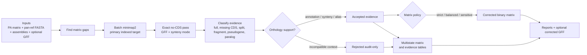

<div align="center">
  
  <h1>Recore</h1>
  <p><strong>Post-hoc rescue, audit, and quality control of pangenome presence/absence matrices.</strong></p>

  <p>
    <a href="https://github.com/PathoGenOmics-Lab/recore/actions/workflows/ci.yml"></a>
    <a href="LICENSE"></a>
    
  </p>
</div>

Pangenome pipelines can mark a gene as absent even when the sequence is still
present in the assembly. These false absences inflate the accessory genome,
shrink the core genome, and create noisy lineage-specific signals.

Recore searches each absent gene against the genome assemblies with minimap2,
classifies the evidence, validates orthology when annotations/synteny are
available, and writes both:

- a **Panaroo-compatible corrected binary matrix** for downstream analyses
- a **multistate evidence matrix** for audit, plotting, and manuscript review

The central design choice is conservative: Recore separates **sequence evidence**
from **clean binary presence**. Full-length evidence can be corrected in the
binary matrix, while partial homology, pseudogenes, paralog traps, and
incompatible-context hits remain visible in audit outputs instead of silently
becoming presence calls.

## Table of Contents

- [Quick Start](#quick-start)
- [Which Matrix Policy Should I Use?](#which-matrix-policy-should-i-use)
- [How It Works](#how-it-works)
- [Benchmark](#benchmark)
- [Inputs](#inputs)
- [Installation](#installation)
- [Usage Profiles](#usage-profiles)
- [Output Files](#output-files)
- [Evidence States](#evidence-states)
- [Rescue Types](#rescue-types)
- [Algorithm Notes](#algorithm-notes)
- [Comparison With Panaroo Refinding](#comparison-with-panaroo-refinding)
- [What Recore Does Not Claim](#what-recore-does-not-claim)
- [Documentation](#documentation)
- [Changelog](#changelog)
- [Citation](#citation)

## Quick Start

Use this for a publication-grade correction pass when FASTA assemblies and GFF
annotations are available:

```bash
recore \
  -p gene_presence_absence.csv \
  -r pan_genome_reference.fa \
  -g genomes/ \
  -a annotations/ \
  --synteny \
  --multi-allele \
  --nscluster \
  --nsc-engine mmseqs2 \
  --nsc-min-seq-id 0.9 \
  --nsc-coverage 0.8 \
  --preset asm5 \
  --min-prevalence 0.05 \
  --matrix-policy balanced \
  --reference-genome AS00146 \
  -t 8 \
  -o recore_output/
```

Most users should start with:

- `--matrix-policy balanced` for the corrected binary matrix
- `gene_presence_absence_recore_states.csv` for audit and figures
- `orthology_evidence.tsv` for publication wording and manual review
- `reference_genome_audit.tsv` when asking whether clusters are truly absent
  from a reference genome
- `reference_cluster_events.tsv` to flag reference-absent clusters that look
  like event-derived alleles/fragments of a reference gene
- `evolutionary_events.tsv` to interpret each cluster as an acquisition,
  loss, IS interruption, pseudogene, paralog/duplication, reference-derived
  allele, context shift, or unresolved accessory signal

## Which Matrix Policy Should I Use?

Recore always records detected evidence in audit files. The matrix policy only
controls which accepted evidence is inserted into the **binary** corrected
matrix.

| Goal | Recommended policy | What it corrects | What stays audit-only |
|------|--------------------|------------------|------------------------|
| Paper-ready binary PA matrix | `balanced` | strict same-locus calls, alias clusters, and full-length sequence evidence | pseudogenes, partial homology, context-rejected hits |
| Maximum conservatism | `strict` | only strict same-locus and alias-cluster evidence | full sequence-only hits without annotation/synteny support |
| Exploratory rescue | `sensitive` | all accepted evidence, including partial/disrupted calls | only rejected context/paralog traps |

Recommended wording:

> We used Recore with the balanced matrix policy, which rescues full-length false
> absences while retaining partial or disrupted homologues as multistate
> audit-only evidence.

## How It Works



Key idea: the corrected binary matrix is not the only output. Recore also
keeps the evidence trail that explains why a cell was corrected, retained as
audit-only, or rejected.

## Benchmark

Recore includes a synthetic benchmark that creates known false absences, true
absences, and partial pseudogenes, then computes precision/recall/F1 from the
actual corrected matrices.


Current synthetic benchmark:

| Policy | TP | FP | FN | Precision | Recall | F1 |
|--------|----|----|----|-----------|--------|----|
| `strict` | 0 | 0 | 5 | NA | 0.000 | 0.000 |
| `balanced` | 5 | 0 | 0 | 1.000 | 1.000 | 1.000 |
| `sensitive` | 5 | 2 | 0 | 0.714 | 1.000 | 0.833 |

Interpretation:

- `strict` is conservative in annotation-free settings.
- `balanced` recovers full-length false absences without converting partial
  pseudogenes into binary presence.
- `sensitive` maximizes recall but accepts partial pseudogene evidence as
  binary presence, creating false positives in this benchmark.

Reproduce:

```bash
python3 benchmarks/synthetic_benchmark.py
```

If `minimap2` is outside `PATH`:

```bash
python3 benchmarks/synthetic_benchmark.py --minimap2 /path/to/minimap2
```

This benchmark validates policy behavior on synthetic ground truth. It is not a
species-specific biological truth benchmark.

## Inputs

| Input | Required | Description |
|-------|----------|-------------|
| `gene_presence_absence.csv` | yes | Panaroo-style matrix with metadata columns followed by genome columns |
| `pan_genome_reference.fa` | yes | Cluster representative sequences; FASTA IDs must match matrix cluster names |
| genome FASTAs | yes | One assembly per matrix genome column |
| GFF annotations | optional, recommended | Enables annotation-aware SPLIT, START_VARIANT, PARALOG, pseudogene, and synteny classification |
| reference genome name | optional | Used by `--reference-genome` to audit whether clusters are absent from a chosen reference |

Input checklist:

- Matrix genome columns should match FASTA/GFF file stems, or contain the same
  embedded `ASxxxxx` identifier.
- Pan-reference FASTA cluster names must match the `Gene` column.
- Use GFFs whenever possible; without GFFs, Recore can still detect full-length
  sequence evidence and some partial/deletion evidence, but it cannot reliably
  distinguish SPLIT, START_VARIANT, and PARALOG by annotation overlap.
- Use `--synteny` with GFFs when paralogy or multi-locus clusters are plausible.
- Use `--multi-allele` when clusters have divergent alleles.
- Use `--min-prevalence 0.0` for exhaustive audits and a higher value such as
  `0.05` to reduce rare-cluster noise in large publication runs.

## Installation

### From Source

```bash
git clone https://github.com/PathoGenOmics-Lab/recore.git
cd recore
cargo build --release
```

Binary:

```bash
target/release/recore
```

Requirements:

- Rust 1.70 or newer
- [minimap2](https://github.com/lh3/minimap2) in `PATH`

Optional:

- [MMseqs2](https://github.com/soedinglab/MMseqs2) for alignment-based
  nucleotide similarity clustering with `--nsc-engine mmseqs2`

### Pre-Built Binaries

Tagged releases build Linux and macOS binaries through GitHub Actions. See
[Releases](https://github.com/PathoGenOmics-Lab/recore/releases).

## Usage Profiles

### Full Publication Run

```bash
recore \
  -p gene_presence_absence.csv \
  -r pan_genome_reference.fa \
  -g genomes/ \
  -a annotations/ \
  --synteny \
  --multi-allele \
  --nscluster \
  --nsc-engine mmseqs2 \
  --matrix-policy balanced \
  --reference-genome AS00146 \
  -t 8 \
  -o recore_output/
```

### Lightweight Rescue Without GFFs

```bash
recore \
  -p gene_presence_absence.csv \
  -r pan_genome_reference.fa \
  -g genomes/ \
  --matrix-policy balanced \
  -t 8 \
  -o recore_output/
```

Use this when annotations are unavailable. It can still rescue full-length
sequence evidence, but annotation-specific classifications are limited.

### Exhaustive Reference Audit

```bash
recore \
  -p gene_presence_absence.csv \
  -r pan_genome_reference.fa \
  -g genomes/ \
  -a annotations/ \
  --synteny \
  --multi-allele \
  --reference-genome AS00146 \
  --min-prevalence 0.0 \
  --matrix-policy balanced \
  -t 8 \
  -o recore_reference_audit/
```

Use this to classify whether clusters are genuinely absent from a reference
background, reference-like, partial, alias-like, paralogous, or already present.

### Built-In NSC Engine

If MMseqs2 is not installed, omit the engine flag and use the built-in MinHash
engine:

```bash
recore \
  -p gene_presence_absence.csv \
  -r pan_genome_reference.fa \
  -g genomes/ \
  --nscluster \
  --nsc-engine minhash \
  -o recore_output/
```

## Output Files

```
recore_output/
├── gene_presence_absence_recore.csv        # corrected Panaroo-compatible binary matrix
├── gene_presence_absence_recore_states.csv # multistate evidence matrix
├── rescue_report.tsv                       # accepted rescue events
├── orthology_evidence.tsv                  # accepted/rejected evidence with wording guidance
├── reference_genome_audit.tsv              # reference-specific audit when --reference-genome is set
├── reference_cluster_events.tsv            # event-derived reference-gene variants, audit-only
├── evolutionary_events.tsv                 # evolutionary pattern and mechanism audit
├── synteny_rejected_report.tsv             # explicit synteny FAIL candidates
├── paralog_rejected_report.tsv             # PARALOG candidates lacking synteny support
├── cluster_locus_context.tsv               # per-cluster locus-context rows when GFFs are loaded
├── cluster_locus_summary.tsv               # cluster-level context stability flags
├── cluster_relationships.tsv               # SPLIT/PARALOG/annotation-match/NSC relationships
├── nscluster_report.tsv                    # NSC groups when --nscluster is enabled
├── corrected_gff/                          # optional GFF3 files with appended Recore CDSs
└── summary.txt                             # run summary
```

For publication figures:

- Use `gene_presence_absence_recore.csv` for binary presence/absence analyses.
- Use `gene_presence_absence_recore_states.csv` when plotting uncertainty,
  pseudogenes, partial homology, or rejected contexts.
- Use `orthology_evidence.tsv` to justify whether a cluster is "present",
  "partial/disrupted", "possible paralog", or "not supported".
- Use `reference_genome_audit.tsv` to support claims such as "absent from
  H37Rv/reference" instead of relying only on the original matrix. The
  `publication_confidence` column flags clean absences separately from
  complex partial/paralogous or event-derived reference evidence.
- Use `reference_cluster_events.tsv` to keep clusters separate in the matrix
  while reporting whether their representative sequence is best explained as
  a short/long in-frame allele, full-length same-gene sequence, frameshift-like
  length change, or partial homology to a gene in the audited reference.
- Use `evolutionary_events.tsv` to separate phylogenetic pattern from molecular
  mechanism: ancestral retention/loss, clade-associated gain, homoplasy,
  IS-supported interruption, pseudogenization, duplication/paralogy,
  reference-derived alleles, and context-shift candidates.

## Evidence States

The multistate matrix uses the same shape as the original PA matrix but stores
biological states:

| State | Meaning | Binary correction under `balanced` |
|-------|---------|------------------------------------|
| `PRESENT_INPUT` | Present in the original matrix | already present |
| `ABSENT` | No accepted evidence found | no |
| `STRICT_PRESENT` | Same-locus evidence from annotation/synteny | yes |
| `ALIAS_CLUSTER` | Same biological locus assigned to another cluster | yes |
| `SEQUENCE_ONLY` | Full-length sequence evidence without stronger annotation context | yes |
| `MISSING_CDS_UNVALIDATED` | Full-length sequence falls in a locus with no CDS annotation but lacks synteny support | no |
| `PARTIAL_HOMOLOGY` | Partial homologous sequence | no |
| `PSEUDOGENE` | Disrupted gene evidence | no |
| `HOMOLOG_PARALOG` | Homologous/paralogous hit | no |
| `REJECTED_CONTEXT` | Candidate rejected by context/paralog checks | no |

## Rescue Types

| Type | Description | Typical interpretation |
|------|-------------|------------------------|
| `DROPPED` | Full-length gene sequence present but missing from matrix | false absence caused by graph cleaning or annotation transfer |
| `MISSING_CDS` | Full-length gene sequence present at a locus where the GFF has no substantial CDS overlap | annotation omission; corrected only when synteny validates the locus |
| `SPLIT` | Hit overlaps a CDS assigned to another cluster | cluster split or alias |
| `FRAGMENTED` | Gene reconstructed from multiple biological fragments | possible disrupted or split locus |
| `ALIGNMENT_SPLIT` | Multiple alignments reconstruct the gene without strong biological break evidence | alignment-level split, audit carefully |
| `START_VARIANT` | Same CDS with a shifted start | start-site/annotation disagreement |
| `PARALOG` | Similar locus but not clearly the same gene | not corrected unless synteny supports it |
| `PSEUDOGENE` | Internal stop, frameshift, or partial deletion | disrupted homologue, audit-only under `balanced` |

Pseudogene sub-types:

| Sub-type | Signal | Interpretation |
|----------|--------|----------------|
| `InternalStop` | in-frame premature stop codon | nonsense disruption |
| `Frameshift` | fragment gaps not divisible by 3 | indel disrupting the reading frame |
| `PartialDeletion` | high identity but 60-80% query coverage | truncated gene |

## Parameters

### Core Parameters

| Parameter | Default | Description |
|-----------|---------|-------------|
| `-p, --presence-absence` | required | Panaroo `gene_presence_absence.csv` |
| `-r, --pan-reference` | required | Panaroo `pan_genome_reference.fa` |
| `-g, --genomes` | required | directory of genome FASTA files |
| `-a, --annotations` | optional | directory of GFF/GFF3 annotations |
| `-o, --output` | `recore_output/` | output directory |
| `--min-identity` | `90.0` | minimum percent identity for a hit |
| `--min-coverage` | `80.0` | minimum query coverage for full rescue |
| `--preset` | `asm5` | minimap2 preset; use `asm20` for more divergent genomes |
| `--min-prevalence` | `0.1` | skip rescue for clusters below this prevalence |
| `--matrix-policy` | `balanced` | binary correction policy: `strict`, `balanced`, or `sensitive` |
| `--multi-allele` | off | query all alleles per cluster |
| `--synteny` | off | validate rescues by flanking gene context; requires GFFs |
| `--reference-genome` | optional | audit one reference/background genome |
| `--tree` | optional | rooted Newick tree for parsimony-based evolutionary event interpretation |
| `--write-corrected-gff` | off | write GFF3 files with appended rescued CDS features |
| `-t, --threads` | `4` | number of threads |

### Nucleotide Similarity Clustering

| Parameter | Default | Description |
|-----------|---------|-------------|
| `--nscluster` | off | enable nucleotide similarity clustering |
| `--nsc-engine` | `minhash` | `minhash` built-in or `mmseqs2` alignment-based |
| `--nsc-kmer-size` | `21` | k-mer size for MinHash sketching |
| `--nsc-threshold` | `0.8` | max-containment threshold for MinHash merging |
| `--nsc-min-seq-id` | `0.9` | minimum identity for MMseqs2 clustering |
| `--nsc-coverage` | `0.8` | bidirectional coverage for MMseqs2 clustering |

## Algorithm Notes

### Batch Search

Recore avoids one minimap2 process per genome:

1. Write all required cluster sequences to one query FASTA.
2. Concatenate all target genomes with prefixed contig names
   (`genome|||contig`).
3. Build one minimap2 index.
4. Run one minimap2 alignment.
5. Stream and demultiplex PAF hits back to `(genome, cluster)` gaps.

This keeps large pangenome audits fast and memory-stable.

### Synteny Model

When `--synteny` is enabled, Recore compares flanking gene context around the
candidate rescue with contexts from genomes where the cluster is already
present. The model uses recurrent compatible contexts, not one fragile exact
string, so minor annotation boundary differences do not create artificial
failures. Explicit incompatible contexts are rejected and written to audit
tables.

### Nucleotide Similarity Clustering

`--nscluster` detects clusters that are distinct at the protein/annotation
level but nearly identical at the nucleotide level.

Two engines are available:

- **MinHash**: built-in, dependency-free, fast approximate clustering.
- **MMseqs2**: optional alignment-based clustering, recommended when exact
  nucleotide identity/coverage thresholds are needed.

## Comparison With Panaroo Refinding

| Feature | Panaroo `--refind_prop_match` | Recore |
|---------|-------------------------------|--------|
| Timing | during graph cleaning | post-hoc on final matrix |
| Aligner | BLAST-style refinding | batch minimap2 |
| Output | binary found/not found | binary matrix plus multistate audit |
| Classification | limited | dropped, split, fragment, start variant, paralog, pseudogene |
| Pseudogene handling | not explicit | stops, frameshifts, partial deletions |
| Paralog control | limited | synteny and context rejection |
| Cluster redundancy | not addressed | optional nucleotide similarity clustering |
| Reference-specific audit | no | yes, via `--reference-genome` |
| Corrected GFF export | no | optional |

## What Recore Does Not Claim

Recore is an audit and correction layer, not an oracle. In particular:

- It does not claim that every homologous sequence is a functional gene.
- It does not turn pseudogenes or partial homologues into clean binary presence
  under the recommended `balanced` policy.
- It does not infer ancestry or biological novelty by itself; use
  `reference_genome_audit.tsv`, phylogeny, synteny, and external evidence.
- It does not replace manual review for complex paralogous families, repetitive
  elements, or collapsed assemblies.
- It cannot recover evidence that is absent from the assembly sequence.

This is why Recore writes both a corrected binary matrix and audit-grade
evidence tables.

## Documentation

Additional details are in [docs/](docs/):

| Document | Description |
|----------|-------------|
| [algorithm.md](docs/algorithm.md) | pipeline phases, data structures, and complexity |
| [rescue_types.md](docs/rescue_types.md) | rescue classes and biological interpretation |
| [output_files.md](docs/output_files.md) | output schemas and coordinate conventions |
| [parameters.md](docs/parameters.md) | complete parameter guide |
| [benchmarks/README.md](benchmarks/README.md) | synthetic benchmark design and reproduction |

## Changelog

Version-to-version changes are tracked in [CHANGELOG.md](CHANGELOG.md).

## Development

```bash
cargo fmt
cargo test
cargo clippy --all-targets -- -D warnings
python3 benchmarks/synthetic_benchmark.py
```

## Citation

If you use Recore, please cite:

> Ruiz-Rodriguez P, et al. (2026). Recore: post-hoc rescue and quality control
> of pangenome presence/absence matrices. *In preparation.*

## Contact

Paula Ruiz-Rodriguez - paula.ruiz.rodriguez@csic.es

## License

GNU General Public License v3.0. See [LICENSE](LICENSE).
