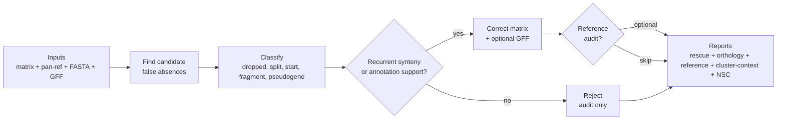

<div align="center">
  
  <h1>Recore</h1>
  <p><strong>Post-hoc rescue and quality control of pangenome presence/absence matrices.</strong></p>
</div>

Pangenome tools sometimes report genes as absent when they are actually present — inflating the accessory genome and shrinking the core. Recore detects and corrects these false negatives by searching each "absent" gene against the genome assembly with minimap2, classifying the reason for absence, and optionally merging nucleotide-redundant clusters.

Written in Rust for speed and low memory. Single-invocation batch minimap2 with pre-indexing and streamed PAF parsing.

## Features

- **False absence rescue** — Recovers genes missed by pangenome graph cleaning, split across clusters, or fragmented by IS elements
- **Diagnostic classification** — Every rescue is typed (DROPPED, SPLIT, FRAGMENTED, ALIGNMENT_SPLIT, START_VARIANT, PARALOG, PSEUDOGENE) with confidence scoring
- **Pseudogene detection** — Identifies disrupted genes: internal stop codons, frameshifts, partial deletions
- **Nucleotide similarity clustering** — Merges Panaroo clusters that are redundant at the DNA level (split at AA but identical at nucleotide)
- **Cluster relationship report** — Summarizes SPLIT/PARALOG/annotation-match/NSC evidence between clusters with reproducible collapse/review recommendations
- **Orthology evidence audit** — Writes accepted/rejected candidate evidence and cluster-level locus-context summaries to catch multi-locus clusters and paralog traps
- **Reference-genome audit** — Optional `--reference-genome` report classifying each cluster as cleanly absent, reference-like, alias, partial, paralog, or already present
- **Synteny validation** — Optional recurrent flanking gene comparison to confirm orthology
- **Genome/GFF name reconciliation** — Resolves FASTAs by embedded AS IDs and normalizes single-contig GFF seqids to the FASTA contig name used by minimap2
- **Corrected GFF export** — Optional per-genome GFF3 files with rescued CDS features appended
- **Batch architecture** — One minimap2 invocation for all genomes, streamed PAF, rayon parallelism

## How it works



Key idea: Recore first finds sequence evidence, then decides whether the hit is
the same locus. Incompatible-context candidates are kept for audit but are not
inserted into the corrected matrix.

## Installation

### From source

```bash
git clone https://github.com/PathoGenOmics-Lab/recore.git
cd recore
cargo build --release
# Binary: target/release/recore
```

**Requirements:** Rust ≥1.70, [minimap2](https://github.com/lh3/minimap2) in PATH

**Optional:** [MMseqs2](https://github.com/soedinglab/MMseqs2) for alignment-based NSC (`--nsc-engine mmseqs2`)

### Pre-built binaries

See [Releases](https://github.com/PathoGenOmics-Lab/recore/releases).

## Usage

### Recommended (gold standard)

The recommended command enables all correction layers: annotation-aware rescue
with synteny validation, multi-allele sensitivity, pseudogene detection, and
alignment-based nucleotide similarity clustering via MMseqs2.

```bash
recore \
  -p gene_presence_absence.csv \
  -r pan_genome_reference.fa \
  -g genomes/ \
  -a annotations/ \
  --synteny \
  --multi-allele \
  --nscluster \
  --nsc-engine mmseqs2 \
  --nsc-min-seq-id 0.9 \
  --nsc-coverage 0.8 \
  --preset asm5 \
  --min-prevalence 0.05 \
  --matrix-policy balanced \
  --reference-genome AS00146 \
  -t 8 \
  -o recore_output/
```

| Flag | Why |
|------|-----|
| `-a annotations/` | GFF directory — enables SPLIT, START_VARIANT, PARALOG, and PSEUDOGENE classification (not just DROPPED) |
| `--synteny` | Validates rescues by comparing flanking gene context — rejects spurious paralog rescues |
| `--matrix-policy balanced` | Controls what enters the binary corrected matrix: `strict`, `balanced`, or `sensitive` |
| `--reference-genome AS00146` | Writes `reference_genome_audit.tsv`, resolving exact names or embedded AS identifiers such as `L4_AS00146` |
| `--multi-allele` | Queries all allelic variants per cluster instead of just the longest — more sensitive for diverse datasets |
| `--write-corrected-gff` | Writes per-genome GFF3 files with Recore rescue features appended |
| `--nscluster` | Merges Panaroo clusters that are identical at the DNA level but were split at the amino-acid level — reduces inflated accessory genome |
| `--nsc-engine mmseqs2` | Alignment-based clustering (exact) instead of MinHash (approximate) — requires [MMseqs2](https://github.com/soedinglab/MMseqs2) in PATH |
| `--nsc-min-seq-id 0.9` | 90% nucleotide identity threshold for merging redundant clusters |
| `--nsc-coverage 0.8` | 80% bidirectional coverage required for merging |
| `--preset asm5` | minimap2 preset for ≤5% sequence divergence — appropriate for most bacterial species |
| `--min-prevalence 0.05` | Only rescue clusters present in ≥5% of genomes — truly rare genes are likely genuine accessory |
| `-t 8` | Number of threads — adjust to available cores |

> **No MMseqs2?** Replace `--nsc-engine mmseqs2` with the default (`--nsc-engine minhash`)
> or simply omit it. The built-in MinHash engine has zero dependencies and gives
> comparable results for most datasets.

### Basic (rescue only, no annotations)

```bash
recore \
  -p gene_presence_absence.csv \
  -r pan_genome_reference.fa \
  -g genomes/ \
  -o recore_output/
```

### Without annotations (lightweight)

If GFF files are not available, Recore still rescues genes but classifies
everything as DROPPED (no SPLIT/PARALOG/PSEUDOGENE distinction).

```bash
recore \
  -p gene_presence_absence.csv \
  -r pan_genome_reference.fa \
  -g genomes/ \
  --nscluster --nsc-engine mmseqs2 \
  -t 8 \
  -o recore_output/
```

## Parameters

### Core

| Parameter | Default | Description |
|-----------|---------|-------------|
| `-p, --presence-absence` | — | Panaroo `gene_presence_absence.csv` |
| `-r, --pan-reference` | — | Panaroo `pan_genome_reference.fa` |
| `-g, --genomes` | — | Directory of genome FASTA files |
| `-a, --annotations` | — | Directory of GFF files (enables rescue classification) |
| `-o, --output` | `recore_output/` | Output directory |
| `--min-identity` | 90.0 | Minimum % identity for a hit |
| `--min-coverage` | 80.0 | Minimum % query coverage |
| `-t, --threads` | 4 | Number of threads |
| `--preset` | `asm5` | minimap2 preset (`asm5` ≤5% divergence, `asm20` ≤20%) |
| `--min-prevalence` | 0.1 | Skip clusters present in fewer genomes |
| `--multi-allele` | off | Query all alleles per cluster (slower, more sensitive) |
| `--synteny` | off | Validate rescues by flanking gene conservation |
| `--write-corrected-gff` | off | Write `corrected_gff/*.recore.gff3` files with rescue features appended |
| `--matrix-policy` | `balanced` | Binary matrix policy: `strict` corrects only `STRICT_PRESENT`/`ALIAS_CLUSTER`; `balanced` also corrects full `SEQUENCE_ONLY` evidence; `sensitive` also corrects partial/disrupted accepted evidence |
| `--reference-genome` | — | Audit one genome column/reference background by exact name or embedded `ASxxxxx` identifier |

### Nucleotide similarity clustering

| Parameter | Default | Description |
|-----------|---------|-------------|
| `--nscluster` | off | Enable nucleotide similarity clustering |
| `--nsc-engine` | `minhash` | Engine: `minhash` (built-in) or `mmseqs2` (requires mmseqs2) |
| `--nsc-kmer-size` | 21 | k-mer size for MinHash sketching |
| `--nsc-threshold` | 0.8 | Max containment threshold for MinHash merging |
| `--nsc-min-seq-id` | 0.9 | Minimum identity for MMseqs2 linclust |
| `--nsc-coverage` | 0.8 | Minimum coverage for MMseqs2 linclust |

## Genome and GFF name matching

Recore first matches genome FASTA and GFF files by the exact matrix column name.
If that fails, it falls back to the embedded `ASxxxxx` identifier. This allows a
matrix column such as `L4_AS00146` to resolve to `AS00146.fna`.

For single-contig assemblies, Recore also reconciles GFF seqids with FASTA contig
names before annotation-based classification and synteny validation. For example,
a GFF seqid such as `contig_1` or `L4_AS00146` is mapped internally to FASTA
contig `AS00146`. Original GFF files are not modified.

## Rescue types

| Type | Description | When |
|------|-------------|------|
| **DROPPED** | Gene present but removed by graph cleaning | Full coverage hit, no annotation conflict |
| **SPLIT** | Gene locus assigned to a different Panaroo cluster | Hit overlaps CDS from another cluster (≥95% id) |
| **FRAGMENTED** | Gene broken into ≥2 biological fragments | Co-linear multi-hit chain with a large query/target gap |
| **ALIGNMENT_SPLIT** | Gene reconstructed by ≥2 alignments without biological break evidence | Small co-linear split alignments, reported separately from FRAGMENTED |
| **START_VARIANT** | CDS present with different start codon | Length differs <300bp from overlapping CDS |
| **PARALOG** | Hit overlaps a similar but distinct gene | Hit on CDS from another cluster (<95% id) |
| **PSEUDOGENE** | Gene disrupted: no longer functional | Three sub-types (see below) |

### Pseudogene sub-types

| Sub-type | Signal | Biological interpretation |
|----------|--------|---------------------------|
| **InternalStop** | In-frame stop codons in the hit region | Premature termination (nonsense mutation) |
| **Frameshift** | Fragments with gaps not divisible by 3 | Reading frame disruption (indel) |
| **PartialDeletion** | High identity (≥90%) but 60–80% coverage | Truncated gene (large deletion) |

## Output

```
recore_output/
├── gene_presence_absence_recore.csv   # Corrected matrix (Panaroo-compatible)
├── gene_presence_absence_recore_states.csv # Multistate matrix for audit/plotting
├── rescue_report.tsv                  # Per-rescue details
├── orthology_evidence.tsv             # Accepted and rejected candidate evidence
├── reference_genome_audit.tsv         # Reference-specific absent/present audit (if --reference-genome)
├── synteny_rejected_report.tsv        # Explicit synteny FAIL candidates, if any
├── paralog_rejected_report.tsv        # PARALOG hits without synteny support, if any
├── cluster_locus_context.tsv          # Per-cluster locus-context rows (if GFFs are loaded)
├── cluster_locus_summary.tsv          # Cluster-level context stability flags (if GFFs are loaded)
├── cluster_relationships.tsv          # Inter-cluster rescue/NSC relationships
├── nscluster_report.tsv               # NS cluster memberships (if --nscluster)
├── corrected_gff/                     # Per-genome GFF3s (if --write-corrected-gff)
└── summary.txt                        # Statistics
```

### rescue_report.tsv

| Column | Description |
|--------|-------------|
| `gene_cluster` | Panaroo cluster name |
| `genome` | Genome where the gene was rescued |
| `rescue_type` | Classification with details |
| `identity` | % identity of the minimap2 hit |
| `coverage` | % query coverage (merged for fragments) |
| `contig` | Target contig |
| `start` / `end` | Coordinates on contig |
| `strand` | +/- |
| `confidence` | Score for conflict resolution (0–1+) |
| `synteny` | PASS/FAIL (if `--synteny`) |
| `annotation_match` | Overlapping CDS gene ID (if `-a`) |
| `fragment_*` | Fragment-chain evidence for multi-hit rescues: count, query/target gaps, colinearity, same-CDS support, and note |

### gene_presence_absence_recore.csv

Drop-in replacement for Panaroo's output:
- Rescued cells: `RESCUED:contig:start-end`
- NSC-merged cells: `NSC_MERGED` (if `--nscluster`)
- Redundant clusters removed (merged into representative)
- Metadata columns recalculated

Binary corrections are controlled by `--matrix-policy`. The default
`balanced` policy does not turn pseudogenes or partial/fragmented homology into
clean binary presence, but those calls are retained in the multistate matrix and
audit tables.

### gene_presence_absence_recore_states.csv

Same shape as the Panaroo matrix, but genome cells contain biological states:
`PRESENT_INPUT`, `ABSENT`, `STRICT_PRESENT`, `ALIAS_CLUSTER`, `SEQUENCE_ONLY`,
`PARTIAL_HOMOLOGY`, `PSEUDOGENE`, `HOMOLOG_PARALOG`, or
`REJECTED_CONTEXT`. Use this file for manuscript plots and manual review when a
binary presence/absence matrix would hide important biology.

### nscluster_report.tsv

| Column | Description |
|--------|-------------|
| `ns_cluster` | NS cluster ID |
| `representative` | Representative cluster (highest prevalence) |
| `n_members` | Number of merged clusters |
| `members` | Semicolon-separated list of member cluster names |

## Architecture

### Batch search strategy

Recore avoids spawning N separate minimap2 processes:

1. All genome FASTAs concatenated with prefixed contig names (`genome|||contig`)
2. minimap2 index (`.mmi`) built once on the concatenated target
3. All query sequences searched in a single minimap2 invocation
4. PAF output streamed and demuxed back to per-(genome, cluster) groups
5. Hit classification parallelised with rayon

### Nucleotide similarity clustering

Two engines for detecting DNA-level redundancy among Panaroo clusters:

**MinHash** (built-in, no dependencies):
- Bottom-k MinHash sketching (128 hashes per cluster)
- Canonical k-mer hashing (strand-independent)
- LSH banding pre-filter reduces O(n²) to O(n × candidates)
- Max Jaccard containment metric (handles variable-length genes)
- Union-Find clustering

**MMseqs2** (optional, exact):
- Linear-time linclust with alignment-based identity
- Bidirectional coverage mode
- Connected component clustering

### Type safety

Newtype wrappers (`ClusterIdx`, `GenomeIdx`) prevent index confusion at compile time. `PresenceAbsence` matrix is encapsulated with a typed accessor API.

## How does this differ from Panaroo's `--refind_prop_match`?

| Feature | Panaroo refind | Recore |
|---------|---------------|--------|
| Timing | During graph cleaning | Post-hoc (on final output) |
| Aligner | BLAST | minimap2 (batch) |
| Classification | Binary (found/not found) | 8 types with sub-classification |
| Pseudogene detection | No | Yes (stops, frameshifts, deletions) |
| Redundancy correction | No | NSC merges DNA-redundant clusters |
| Validation | None | Synteny + conflict resolution |
| Multi-allele | No | Yes (`--multi-allele`) |
| Speed | Slow (BLAST per genome) | Fast (single minimap2, streamed, parallel) |

## Citation

If you use Recore, please cite:

> Ruiz-Rodriguez P, et al. (2026). Recore: post-hoc rescue and quality control of pangenome presence/absence matrices. *In preparation.*

## Contact

Paula Ruiz-Rodriguez — paula.ruiz.rodriguez@csic.es

## License

GNU General Public License v3.0
