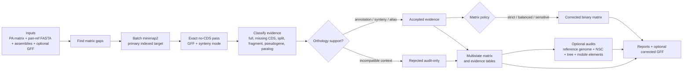

# Algorithm

## The pipeline at a glance

The corrected binary matrix is not the only output. Recore also keeps the
evidence trail that explains why a cell was corrected, retained as audit-only,
or rejected.

## Overview

Recore rescues falsely absent genes from pangenome matrices produced by Panaroo (or Roary). It takes a gene presence/absence CSV, the pan-genome reference FASTA, individual genome FASTAs, and (optionally) GFF annotations, then identifies genes that are physically present in genomes but missing from the matrix.

The pipeline runs in 12 sequential phases. Each phase is deterministic given the same inputs and thread count.

---

## Phase 1: Input Parsing

### Presence/absence matrix

Parses Panaroo's `gene_presence_absence.csv`. The CSV has 13-15 metadata columns (Gene, Annotation, No. isolates, etc.) followed by one column per genome. Each cell is either empty (gene absent) or contains semicolon-separated gene IDs.

The matrix is stored as a `PresenceAbsence` struct with encapsulated access via newtype indices (`ClusterIdx`, `GenomeIdx`) to prevent index confusion.

### Pan-genome reference

Parses Panaroo's `pan_genome_reference.fa`. Each entry has format `>clusterName~~~genomeName description`. The `~~~` separator is stripped to extract the cluster name.

**Single-allele mode** (default): keeps only the longest allele per cluster.  
**Multi-allele mode** (`--multi-allele`): keeps all alleles, increasing sensitivity at the cost of more minimap2 queries.

### Genome FASTAs

Scans the genomes directory for files with extensions `.fasta`, `.fa`, `.fna` (also `.gz` variants). File stems become genome names matched against CSV column headers.

### GFF annotations (optional)

Parses GFF3 files matching genome names. Extracts CDS features only: contig, start, end, strand, gene ID. Coordinates are converted from GFF3's 1-based closed to 0-based half-open (matching minimap2 PAF output). Supports `.gff`, `.gff3`, and gzipped variants. GFF3 percent-encoded attributes are decoded before identifier, alias, product, and note matching.

### Cross-validation

Before proceeding, validates:
- Genome and cluster names are safe for path construction (no `../`, `/`, `\0`)
- The matrix and pan-reference FASTA are not empty
- Genome names and cluster names are unique
- Warns about clusters in CSV but not in reference (and vice versa)
- Warns about genomes without matching FASTA files

---

## Phase 2: Gap Identification

Iterates over every (cluster, genome) pair. A **gap** is any pair where the gene is absent.

Gaps are filtered by **prevalence**: if a cluster is present in fewer than `--min-prevalence` fraction of genomes (default 10%), its gaps are skipped. The rationale is that ultra-rare clusters are likely truly accessory, and searching for them in hundreds of genomes generates cross-match noise.

The remaining gaps are grouped by genome for batch processing.

---

## Phase 3: GFF Index Construction

For each genome with a GFF file, builds a `GffIndex`:

1. Genes sorted by (contig, start position)
2. Per-contig range index for O(log n) overlap queries via binary search (`partition_point`)
3. Gene ID index for O(1) lookup by name

The index supports:
- `overlapping(contig, start, end)` → all CDS features overlapping a query region
- `flanking(contig, start, end)` → nearest upstream and downstream genes
- `get_by_id(gene_id)` → direct lookup

---

## Phase 4: Gene-to-Cluster Maps

For each genome involved in the search, builds a HashMap from gene ID → ClusterIdx. This maps every gene ID found in the CSV cells to its Panaroo cluster assignment.

Panaroo appends suffixes to gene IDs that don't exist in the original GFF:
- `_pseudo` for pseudogene annotations
- `_dup_N` for duplicate gene copies

The map indexes both the original ID and stripped versions to maximize GFF matching success.

---

## Phase 5: Search (minimap2)

This is the computational core. Each genome that has gaps is searched for its own absent clusters, one minimap2 run per genome, in parallel across `--threads`.

### 5a. One genome at a time

A genome's queries are only the clusters absent from it, and its target is only its own assembly. Genomes that carry a cluster never compete with the genome where it is missing.

That isolation is the point. Concatenating every genome into one target looks cheaper, but minimap2's secondary budget (`-N`) and its secondary-to-primary ratio (`-p`) then apply across all genomes at once. Once more than about fifty genomes carry a gene, their full-length copies use up the budget and the gap genome's hit is dropped; a gap genome's weaker copy, or the two pieces of a gene split across contigs, fall under half the carriers' score and are cut. Searched alone, a genome's hits only compete with its own other copies, and each run indexes one assembly rather than the whole pangenome.

### 5b. Query preparation

The cluster sequences a genome needs are written to a temporary FASTA. In multi-allele mode, alleles are named `clusterName~~~ALLELE~0`, `clusterName~~~ALLELE~1`, etc.

### 5c. Target preparation

The genome's FASTA is read by Recore's own reader (plain or gzipped) and written to a temporary file in normalised form: each header is cut to its contig name, line endings are normalised. minimap2 is given that copy rather than the user's file, so the aligner and the rest of the pipeline agree on what the assembly contains. Inputs that would otherwise give confident wrong answers fail here, naming the file and line: sequence before the first `>` header, an empty or non-UTF-8 contig name, and a contig name used twice in one assembly.

### 5d. Alignment

Every pass runs with base-level alignment, so identity and coverage are exact:

- `-c`: base-level alignment. Without it minimap2 reports chain-based match counts, which read a 99.6% identical gene as about 93%, and every identity threshold would be comparing against that.
- `-s 40`: the asm presets ask for a peak alignment score of 200, which with `-c` drops every gene shorter than about 200 bp.
- `--end-bonus 40`: beats the asm5 mismatch penalty, so one SNP near either end of a gene does not clip the alignment short of the gene's end.
- `--secondary=yes -N 500 -p 0.5`: report secondary alignments, needed for split and paralog detection. The budget is per genome.
- Preset `asm5` (default) or `asm20`: controls alignment sensitivity.

### 5e. Hit filtering

Each hit is assigned to its cluster through the query name and filtered by minimum identity (`--min-identity`, default 90%). Identity is exact, so the threshold means what it says.

Result: a map from `(genome, cluster)` to its hits.

---

## Phase 6: Hit Classification

Each (cluster, genome) gap with hits is classified into one of 9 rescue types. Classification follows three paths:

### Path 1: Single full-coverage hit (≥ min_coverage)

The best hit (by query length, then score) covers ≥80% of the reference sequence (default `--min-coverage`). Classification depends on GFF annotation overlap:

Before classification, Recore builds a conservative gene-to-cluster index from
the matrix and the GFF. If one alias of a CDS maps unambiguously to a cluster,
its other aliases (`locus_tag`, `gene`, `Name`, `protein_id`, old locus tags)
are mapped to the same cluster. Ambiguous aliases that point to multiple
clusters are left unresolved.

| Condition | Type | Confidence |
|-----------|------|------------|
| No GFF provided | DROPPED | identity × coverage |
| GFF loaded, no substantial CDS overlaps hit, identity ≥95% | MISSING_CDS | identity × coverage |
| No GFF gene overlaps hit | DROPPED | identity × coverage |
| Overlapping gene belongs to a different cluster, identity ≥ 95% | SPLIT | base × 1.1 |
| Overlapping gene belongs to a different cluster, identity < 95% | PARALOG | base × 0.7 |
| Overlapping gene not in any cluster | DROPPED | identity × coverage |

`MISSING_CDS` is used only when the alignment is full-length and no CDS overlaps more than half of both the hit span and the annotated CDS. Short boundary overlaps with adjacent genes are ignored so a real missing annotation is not swallowed by a neighboring feature.

After initial classification, DROPPED hits undergo **start variant detection**: if the hit has ≥98% identity and a GFF gene within 300bp length difference overlaps ≥80% of the hit, it's reclassified as START_VARIANT.

### Path 2: Conservative fragment-chain assembly (same allele, contig, and strand)

If no single hit has sufficient coverage, hits are first grouped by query allele, query length, target contig, and strand. Recore builds the best co-linear chain within each group and uses only the best chain. This prevents independent alleles or paralogous hits from being merged into a false fragmented gene.

If the best chain reaches `--min-coverage` with ≥2 fragments:
- Non-co-linear chains are not rescued as fragments.
- If the whole chain lies inside one compatible CDS, Recore classifies it through the single-CDS annotation logic (DROPPED, START_VARIANT, SPLIT, or PARALOG) instead of calling FRAGMENTED.
- If average identity is ≥95% and a small gap is not divisible by 3, the event is classified as PSEUDOGENE:Frameshift.
- If the chain has a large query or target gap (≥50 bp), the event is classified as FRAGMENTED.
- Otherwise, the event is classified as ALIGNMENT_SPLIT: the gene is reconstructed by multiple alignments, but the evidence does not support a biological break.

Fragment-chain evidence is written to `rescue_report.tsv` for auditability.

### Path 3: Partial deletion pseudogene

If the best hit has ≥90% identity but only 60-80% coverage (below min_coverage), the gene is classified as PSEUDOGENE:PartialDeletion. Multi-fragment coverage is also considered.

### If none of the paths match → no rescue (gene is truly absent)

---

## Phase 7: Internal Stop Codon Scanning

DROPPED and MISSING_CDS rescues are post-processed for pseudogene detection. For each genome with at least one sequence-only rescue:

1. Load genome FASTA contigs on-demand (not preloaded for all genomes)
2. If the rescue sits on an annotated CDS, extract that CDS and read it in its own frame, from its start codon to its stop, counting stops before the last codon. That is the reading frame this genome's annotation asserts, and it ends at this genome's own stop.
3. Otherwise extract the aligned region, reverse-complement it on the minus strand, and read it in the frame the alignment fixes. The cluster's representative begins at its start codon, so an alignment that starts `q` bases into the representative puts the first whole codon `(3 - q mod 3) mod 3` bases into the region. Count internal stops (TAA, TAG, TGA) before the last codon.
4. Only when neither is known (a rescue built from several alignments) scan all three frames and keep the frame with the fewest.
5. If stops are found, reclassify as PSEUDOGENE:InternalStop, confidence × 0.5

The minimum over three frames is only the last resort: a premature stop in the true frame can hide behind another frame that happens to be stop-free, which G/C-ending codons make common. An unannotated pseudogene of that kind used to be inserted into the matrix as present.

The same alignment start sets the phase of the rescue's CDS feature in `corrected_gff/`.

---

## Phase 8: Synteny Validation

When `--synteny` is enabled and GFF files are loaded, each rescue is validated against the genomic context of reference genomes where the gene IS present.

### Algorithm

For the rescued gene at position (contig, start, end) in the target genome:
1. Build side-specific context windows around the rescued locus using 1, 2, 3, 4, and 5 upstream/downstream CDS neighbours. If the rescue substantially overlaps an annotated CDS, that CDS is used as the centre so short start-site differences and overlapping CDS boundaries do not shift the context. Otherwise the locus midpoint is used, which is important for missing-CDS calls with only tiny overlaps into adjacent genes.
2. For every reference genome where this cluster IS present, in deterministic genome order:
   a. Read every gene ID in the matrix cell, not only the first one. This keeps multi-copy/paralogous clusters from being represented by an arbitrary copy.
   b. Find each reference gene in the GFF (try exact ID, then strip `_pseudo`/`_dup_N` suffixes).
   c. Build the same side-specific context window around each resolved reference gene.
3. Score each target/reference context comparison. Nearest neighbours contribute most, distal neighbours contribute less, upstream/downstream sides are scored separately, and each reference neighbour can be matched only once.
4. A reference context is compatible when its score is at least 0.50 and it satisfies the side rule: if both sides are comparable, at least one upstream and one downstream cluster must match; if only one side is comparable, that side must match.
5. If three or fewer reference genomes have context, one compatible context can validate the rescue. If more than three reference genomes have context, compatibility must be observed in at least two genomes. This prevents a single noisy/paralogous context or several duplicated copies in one genome from validating a rescue in a large dataset.
6. Recore keeps the best assessment across neighbour windows, preferring passing assessments, then higher score, then the smallest informative window.
7. Otherwise -> FAIL.

Explicit FAIL candidates are written to `synteny_rejected_report.tsv` and are not used to correct the output matrix. Rescues with no mappable flanking context remain in `rescue_report.tsv` with `synteny` empty, and so do rescues whose context no genome carrying the cluster can be compared with (for example when those genomes have no GFF): a missing comparison is not an incompatible one.

PARALOG candidates are more conservative: if they do not have explicit `synteny=PASS`, they are written to `paralog_rejected_report.tsv` and are not inserted into the corrected matrix.

MISSING_CDS candidates follow the same conservative matrix rule: `synteny=PASS` upgrades them to `STRICT_PRESENT`; without synteny support they are kept as `MISSING_CDS_UNVALIDATED` audit evidence and are not corrected by any matrix policy.

### Confidence adjustment

- Synteny PASS: confidence × 1.2 (boost)
- Synteny FAIL: confidence × 0.6, then reject from the corrected matrix
- No flanking genes found: no adjustment (synteny_ok = None)

---

## Phase 9: Conflict Resolution

Multiple rescues can overlap on the genome (e.g., a DROPPED and a PARALOG rescue at the same locus). Conflicts are resolved by:

1. Sort rescues by (genome, contig, start position)
2. For substantial overlaps on the same contig (≥50% of the shorter interval): keep the one with higher confidence
3. Single-pass O(n) sweep with a removal bitmap

---

## Phase 10: Nucleotide Similarity Clustering (NSC)

Optional (`--nscluster`). Detects Panaroo clusters that are distinct at the protein level but nearly identical at the nucleotide level (annotation-level redundancy).

### MinHash engine (default, built-in)

1. **Sketch**: Bottom-k MinHash with 128 hashes per cluster. Uses canonical k-mers (min of forward and reverse-complement hash) with FNV-1a hashing over upper-cased bases, so soft-masked sequence sketches like the rest. Multi-allele clusters are concatenated with N-spacers to prevent cross-allele k-mers.

2. **Candidates**: an index from hash value to the sketches holding it. Two clusters are candidates when their sketches share at least two values; a value held by more than 500 sketches (a repeat) is ignored. Positional bands over sorted bottom-k sketches, used before, rarely line up between a gene and a near copy or a fragment of it.

3. **Containment**: For candidate pairs, compute max Jaccard containment (max of containment(A,B) and containment(B,A)). This is more appropriate than Jaccard similarity when genes differ in length. Containment of A in B is estimated over A's hash values no larger than B's largest, which is as far as a full sketch of B can answer; counting the rest as misses put a gene's own first half at about 0.5.

4. **Clustering**: Union-Find with path compression and union-by-rank. Pairs above threshold (default 0.8) are merged.

5. **Representative selection**: Within each merged group, the cluster with highest prevalence becomes the representative. Others are removed from the output, and their presences are unioned into the representative. The union is taken over the **corrected** matrix, not the input one, so the representative can receive merged presence support that Recore itself rescued in a member cluster.

### MMseqs2 engine (optional, exact)

Uses MMseqs2 `linclust` for linear-time clustering with alignment-based identity:
- `createdb` → `linclust` → `createtsv`
- Connected-component clustering mode
- Bidirectional coverage requirement
- Automatic temp directory cleanup

---

## Phase 11: Output Generation

### rescue_report.tsv

One row per rescue event. Columns: gene_cluster, genome, rescue_type, identity, coverage, contig, start (1-based), end, strand, confidence, synteny, quantitative synteny evidence (`synteny_score`, support count, reference context count, selected neighbour window, upstream/downstream matches), ORF integrity signal, annotation_match, plus fragment-chain evidence columns for multi-hit rescues.

### synteny_rejected_report.tsv

Written only when `--synteny` rejects at least one candidate. It uses the same schema as `rescue_report.tsv`, but these rows are audit records only and are not inserted into `gene_presence_absence_recore.csv`.

### paralog_rejected_report.tsv

Written only when PARALOG candidates lack explicit synteny support. It uses the same schema as `rescue_report.tsv`, but these rows are audit records only and are not inserted into `gene_presence_absence_recore.csv`.

### orthology_evidence.tsv

One row per accepted rescue plus rejected synteny or paralog candidate. This table makes the decision layer explicit: accepted/rejected status, orthology status, evidence state (`STRICT_PRESENT`, `ALIAS_CLUSTER`, `SEQUENCE_ONLY`, `PARTIAL_HOMOLOGY`, `PSEUDOGENE`, `HOMOLOG_PARALOG`, `REJECTED_CONTEXT`), matrix action, publication status, annotation-matched cluster, synteny state, quantitative synteny evidence, ORF integrity signal, confidence, coordinates, and rejection reason.

Before an accepted rescue enters the binary matrix, Recore also applies an
adaptive orthology-quality guard. The guard raises the required sequence
identity/coverage for rare or very short clusters, while allowing strong
same-locus evidence such as passing synteny to support strict/alias calls. The
guard writes `adaptive_identity_floor`, `adaptive_coverage_floor`,
`adaptive_sequence_pass`, `orthology_confidence_score`,
`orthology_confidence_tier`, and `risk_flags`. Accepted evidence that passes
the selected `--matrix-policy` but fails this guard is kept as
`audit_only_quality`.

### reference_genome_audit.tsv

Written when `--reference-genome` is provided. The reference can be an exact matrix column or an embedded `ASxxxxx` identifier. For every cluster, Recore reports whether the reference matrix already contains it, whether Recore rescued reference evidence, whether only rejected/paralog/partial evidence exists, or whether no evidence was found. The `reference_absence_class` column is deliberately simple:
- `new_to_reference`: no reference evidence under the current thresholds.
- `reference_like_or_present`: already present or rescued in the audited reference.
- `reference_like_ambiguous`: partial, pseudogene, paralog, or rejected-context evidence; review before calling novel to the reference.

The reference audit also runs an exact reference-only shadow search and keeps a
shadow copy of candidates before conflict resolution. This prevents
partial/paralogous evidence from disappearing simply because it was correctly
excluded from the binary matrix. Such rows are reported as
`flag_reference_partial_paralog_evidence` with
`publication_confidence=complex_paralog`: the exact cluster can remain absent,
but the absence should not be described as a clean absence of the broader
sequence family.

Accepted reference-like rescue evidence is still passed through the adaptive
orthology-quality guard used by the corrected matrix. Weak sequence-only hits
below the dataset-aware identity/coverage floors remain
`reference_like_ambiguous` rather than being promoted to
`reference_like_or_present`.

The reference audit also compares reference-absent cluster representatives
against reference-present cluster representatives. Recore seeds candidate pairs
with canonical 15-mers, globally aligns the best candidates, and classifies
high-confidence matches as full-length same-gene sequence, short/long in-frame
alleles, frameshift-like length changes, or partial reference homology. These
events are written to `reference_cluster_events.tsv` and mirrored in
`reference_genome_audit.tsv` as `EVENT_DERIVED_REFERENCE_CLUSTER` with
`publication_confidence=event_derived`. They are deliberately audit-only:
Recore keeps the cluster as a separate matrix column but prevents downstream
tables from calling it a clean novel gene relative to the reference.

### evolutionary_events.tsv

Written for every run. Recore combines the corrected matrix state, reference
event audit, rescue classifications, synteny rejections, paralog rejections,
cluster locus context, optional GFF mobile-element labels, and optional Newick
tree evidence into one interpretation table.

When `--tree` is provided, Recore performs binary Fitch parsimony per cluster:
tips are matched to matrix columns by exact name or embedded `ASxxxxx` ID, and
gains/losses are counted by a top-down assignment consistent with the Fitch
state sets. If the root state is ambiguous under Fitch, Recore now reports
`ancestral_state=ambiguous` and avoids turning that arbitrary tie-break into an
ancestral-loss claim. This yields phylogenetic patterns such as ancestral
retention, ancestral loss, lineage-specific gain, recurrent gain/loss,
homoplastic gain/loss, ambiguous gain/loss, and singleton/noise-like signals.

The molecular mechanism call is separate from the tree pattern. Recore gives
priority to direct sequence/locus evidence: reference-derived alleles from
`reference_cluster_events.tsv`, IS-supported interruptions from GFF labels,
pseudogene and fragmentation evidence, paralog/duplication signals, context
shifts, acquisition/insertion candidates, deletion/loss candidates, and
unresolved accessory variation. These calls are audit-only and are intended for
manual review and manuscript wording, not automatic binary correction.

The table also reports a `phylogenetic_blink_flag`, an
`evolutionary_signal_score`, and a `highlight_priority`. These combine tree
coherence, mechanism support, synteny, locus-context stability, ORF integrity,
and cluster-component risk so highly dispersed or singleton-like clusters are
easy to filter before manuscript highlighting.

Recore also reports a Dollo-like penalized model. It finds the smallest carrier
MRCA, reports its size and carrier purity, and counts the minimum loss events
inside that MRCA. A compact, high-purity carrier clade is treated as more
plausible than a root-spanning pattern that would require many independent
losses. Root ambiguity and repeated independent gains add
`dollo_violation_count` and reduce `penalized_phylo_score`. This is deliberately
an interpretation aid rather than a binary correction rule.

Mobile-element support has two tiers. If `--mobile-element-reference` is
provided, Recore aligns that nucleotide FASTA of mobile elements, IS, or
transposase loci against genomes with rescue/disruption evidence and reports
nearby hits as `mobile_element_source=sequence`. This path is agnostic to GFF
feature names. If no sequence database hit is available, Recore falls back to
annotation labels (`ID`, aliases, `product`, `Note`) containing terms such as
IS names, insertion sequence, transposase, phage, integrase, or recombinase.
`IS_interruption_supported` is deliberately conservative: it requires a
fragmented or disrupted rescue plus close mobile-element evidence within
250 bp.

### cluster_locus_context.tsv / cluster_locus_summary.tsv

Written when GFF annotations are loaded. Recore builds a two-gene upstream and two-gene downstream context window for each present gene ID that can be resolved in the GFF. The context table lists every observed cluster-side context; the summary table flags clusters as stable single-locus, mostly stable with minor context noise, possible multi-locus/paralog, or insufficient context. Synteny validation uses an adaptive 1-to-5-neighbour model, but this summary remains fixed-width so locus stability can be compared across clusters.

### cluster_synteny_blocks.tsv

Written when GFF annotations are loaded. This audit-only table summarizes
wider five-neighbour upstream/downstream blocks for every resolvable present
cluster. Unique blocks are collapsed by ordered displayed gene/locus identity:
internal cluster gaps, representative coordinates, and gene lengths do not
create additional blocks. One representative locus and the full carrier-genome
set are kept for each unique architecture. It is
intended for reviewing translocations, tandem duplications, or alternative local
contexts without changing the correction matrix. If a reference genome is
known, Recore indexes every boundary between reference genes and chooses the
boundary sharing the largest number of flanking clusters with each observed
block. This provides a reference/H37Rv context row even for clusters absent
from the reference, so users can inspect the neighbouring genes that define the
likely insertion, deletion, disruption, or context-shift slot.

### genome_qc.tsv

Written for every run. Recore summarizes each genome's FASTA/GFF availability,
GFF contig remapping, searchable gaps, accepted rescues, matrix corrections,
NSC-added presence, synteny rejections, and paralog rejections. The `qc_flags`
column highlights genomes that may need assembly or annotation review before
interpreting noisy presence/absence patterns. Successful GFF contig remapping is
kept as an informational flag and does not by itself move a genome from `pass`
to `review`.

### cluster_components.tsv / cluster_component_members.tsv

Written for every run. Recore converts pairwise cluster relationships into
connected components. Edges come from split-cluster evidence, annotation-match
evidence, NSC merges, and paralog evidence. The component tables make it clear
whether a cluster should be reviewed as a possible alias/redundant component or
as part of a paralog family that should remain distinct by default. Component
membership is mirrored in `evolutionary_events.tsv`.

### gene_presence_absence_recore.csv

Drop-in replacement for Panaroo's CSV. Changes:
- Rescued genes: cell value `RESCUED:contig:start-end` (1-based coordinates)
- Binary correction is controlled by `--matrix-policy` (`strict`, `balanced`, `sensitive`) plus the adaptive orthology-quality guard
- NSC-merged genes: cell value `NSC_MERGED`
- Clusters absorbed by NSC are removed (rows dropped)
- Metadata columns (No. isolates, No. sequences) updated to reflect rescues

### gene_presence_absence_recore_states.csv

Same shape as the corrected matrix, but genome cells are states rather than
binary calls: `PRESENT_INPUT`, `ABSENT`, `STRICT_PRESENT`, `ALIAS_CLUSTER`,
`SEQUENCE_ONLY`, `PARTIAL_HOMOLOGY`, `PSEUDOGENE`, `HOMOLOG_PARALOG`, or
`REJECTED_CONTEXT`, and `NOT_SEARCHED_LOW_PREVALENCE`,
`NOT_SEARCHED_NO_CLUSTER_SEQUENCE` or `NOT_SEARCHED_NO_FASTA` for a gap that
was never searched, so it is not mistaken for one searched and found empty. This is the preferred output for plotting or reviewing
ambiguous biology without forcing it into a clean 0/1 matrix.

### summary.txt

Human-readable summary with gap counts, accepted rescues, matrix-corrected
rescues under the selected policy, rescue type breakdown, core/soft-core genome
changes, synteny stats, and NSC stats.

### nscluster_report.tsv (if NSC enabled)

One row per NS cluster: cluster ID, representative name, member count, semicolon-separated member names.

---

## Phase 12: Core Genome Recalculation

After all rescues and NSC merges, the core and soft-core genome sizes are recalculated:

- **Core (strict)**: clusters present in ALL genomes (including rescues and NSC unions)
- **Soft-core (≥95%)**: clusters present in ≥95% of genomes

NSC-merged clusters are excluded from the count (their presences are absorbed into representatives).

---

## Rescue Type Reference

| Type | When | Confidence modifier |
|------|------|-------------------|
| DROPPED | Gene present in genome but cleaned by Panaroo graph cleaning | 1.0× (base) |
| MISSING_CDS | Gene sequence present at a locus with no substantial overlapping CDS in the GFF | 1.0× (base) |
| SPLIT | Gene assigned to wrong Panaroo cluster (≥95% identity to another cluster's gene) | 1.1× |
| FRAGMENTED | Gene broken into ≥2 fragments with combined coverage ≥80% and a large biological gap | 0.8× |
| ALIGNMENT_SPLIT | Gene reconstructed by ≥2 small co-linear alignments without biological break evidence | 0.9× |
| START_VARIANT | Same gene with different start codon (≤300bp length difference) | 0.95× |
| PARALOG | Cross-match to a related gene family (<95% identity) | 0.7× |
| PSEUDOGENE:InternalStop | Internal stop codon(s) in the best reading frame | 0.5× |
| PSEUDOGENE:Frameshift | Fragments with gaps not divisible by 3 | 0.5× |
| PSEUDOGENE:PartialDeletion | High identity (≥90%) but only 60-80% coverage | 0.4× |

---

## Computational Complexity

| Phase | Time | Space |
|-------|------|-------|
| Parsing | O(clusters × genomes) | O(clusters × genomes) |
| Gap filtering | O(clusters × genomes) | O(gaps) |
| GFF indexing | O(genes × log(genes)) per genome | O(genes) per genome |
| minimap2 | O(queries × target_size) | O(streaming), PAF not buffered |
| Classification | O(hits) with rayon parallelism | O(rescues) |
| Internal stops | O(DROPPED_rescues × hit_length) | O(genome) per genome |
| Synteny | O(rescues × neighbour_windows × present_cluster_copies) | O(contexts per cluster) per rescue |
| Conflict resolution | O(rescues × log(rescues)) | O(rescues) |
| NSC MinHash | O(clusters × seq_length) + O(candidates) | O(clusters × sketch_size) |
| NSC MMseqs2 | O(clusters) linear time | O(mmseqs2 internal) |
| Output | O(clusters × genomes) | O(streaming) |
