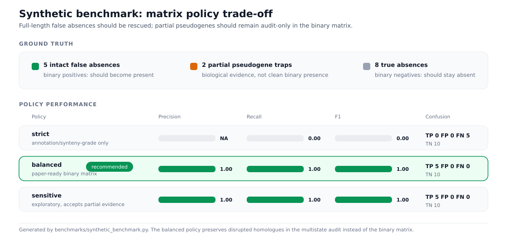

# Limits and comparisons

## What Recore does not claim

Recore is an audit and correction layer, not an oracle.

- It does not claim that every homologous sequence is a functional gene.
- It does not turn pseudogenes or partial homologues into clean binary presence
  under the recommended `balanced` policy.
- It does not prove ancestry or biological novelty by itself. Evolutionary labels
  are audit interpretations, to be read alongside reference evidence, phylogeny,
  synteny and external validation.
- It does not replace manual review for complex paralogous families, repetitive
  elements, or collapsed assemblies.
- It cannot recover evidence that is absent from the assembly sequence.

This is exactly why every run writes both a corrected binary matrix and
audit-grade evidence tables. The binary matrix is what a downstream tool
consumes; the evidence tables are what a reviewer reads.

## Ambiguity is reported as ambiguity

With `--tree`, Fitch parsimony root states that come out ambiguous are reported
as ambiguous rather than being forced into a single ancestral story.
Carrier-MRCA purity and Dollo-like origin and loss metrics are there to separate
a compact clade-associated event from a blinking pattern that happens to have the
same count.

If tree tips do not cover every matrix genome, the unmatched genomes are ignored
and Recore says so explicitly.

## Compared with Panaroo refinding

| Feature | Panaroo `--refind_prop_match` | Recore |
|---------|-------------------------------|--------|
| Timing | during graph cleaning | post-hoc on the final matrix |
| Aligner | BLAST-style refinding | batch minimap2 |
| Output | binary found / not found | binary matrix plus multistate audit |
| Classification | limited | dropped, split, fragment, start variant, paralog, pseudogene |
| Pseudogene handling | not explicit | stops, frameshifts, partial deletions |
| Paralog control | limited | synteny and context rejection |
| Cluster redundancy | not addressed | optional nucleotide similarity clustering |
| Reference-specific audit | no | yes, via `--reference-genome` |
| Corrected GFF export | no | optional |

The two are not alternatives. Panaroo refinding happens while the graph is being
built; Recore runs afterwards on whatever matrix you ended up with, from any
pipeline that writes a Panaroo-style matrix.

## Benchmark results

Recore includes a synthetic benchmark that creates known false absences, true
absences, and partial pseudogenes, then computes precision/recall/F1 from the
actual corrected matrices.

<picture>
  <source media="(prefers-color-scheme: dark)" srcset="../assets/synthetic_benchmark_precision_recall_dark.svg">
  
</picture>

Current synthetic benchmark:

| Policy | TP | FP | FN | Precision | Recall | F1 |
|--------|----|----|----|-----------|--------|----|
| `strict` | 0 | 0 | 5 | NA | 0.000 | 0.000 |
| `balanced` | 5 | 0 | 0 | 1.000 | 1.000 | 1.000 |
| `sensitive` | 5 | 0 | 0 | 1.000 | 1.000 | 1.000 |

Interpretation:

- `strict` is conservative in annotation-free settings.
- `balanced` recovers full-length false absences without converting partial
  pseudogenes into binary presence.
- `sensitive` allows partial/disrupted evidence at the policy layer, but the
  adaptive quality guard still blocks weak pseudogene-like evidence in this
  benchmark.
- No policy converts a homologous/paralogous trap into binary presence unless
  the evidence has already been promoted to same-locus support by synteny.

Reproduce:

```bash
python3 benchmarks/synthetic_benchmark.py
```

If `minimap2` is outside `PATH`:

```bash
python3 benchmarks/synthetic_benchmark.py --minimap2 /path/to/minimap2
```

The biological event benchmark adds a small GFF/synteny truth set. It checks
that a same-locus missing CDS is rescued, an identical paralog in the wrong
context is rejected, and the evolutionary audit table contains quantitative
synteny, ORF, phylogenetic-reliability, and paralog-risk columns.

```bash
python3 benchmarks/biological_event_benchmark.py
```

The synthetic benchmark validates policy behavior on matrix ground truth; the
biological benchmark validates the locus-context guardrails. Neither is a
species-specific biological truth benchmark.

## Run time and memory

Measured with [`benchmarks/search_scaling.py`](https://github.com/PathoGenOmics-Lab/recore/blob/main/benchmarks/search_scaling.py)
on an Apple M4 Pro (14 cores, 24 GB) with 8 threads and minimap2 2.31:
synthetic MTBC-sized genomes (one 4.9 Mb contig and 4,000 genes each), 80
matrix gaps per genome of which 40 are false absences, GFFs and `--synteny`.
The GFFs give each CDS an ID and a locus tag; the last two columns are the
same runs with PGAP-style GFFs (`--rich-gff`), six names per CDS plus a
product and a note.

| Genomes | Gaps searched | Run time | Warm `--search-cache` | Peak memory | PGAP-style GFFs: run time | PGAP-style GFFs: peak memory |
|---------|---------------|----------|-----------------------|-------------|---------------------------|------------------------------|
| 100 | 8,000 | 2.4 s | 1.3 s | 0.24 GB | 2.2 s | 0.32 GB |
| 200 | 16,000 | 4.7 s | 2.8 s | 0.30 GB | 4.2 s | 0.43 GB |
| 400 | 32,000 | 10.7 s | 6.3 s | 0.38 GB | 8.8 s | 0.64 GB |
| 800 | 64,000 | 21.4 s | 13.5 s | 0.56 GB | 20.7 s | 1.05 GB |

Every planted false absence was recovered, except one at 100 genomes that
synteny rejected because the random deletions had changed its neighbourhood.

Memory grows by about 0.5 MB per genome, or 1 MB with PGAP-style GFFs, nearly
all of it the annotation synteny reads for every genome: 5,000 genomes like
these would need about 2.5 GB, or 5.5 GB with PGAP-style GFFs. Each name is
stored once per genome and the gene-to-cluster lookup keeps one cluster per
name; when every name was a String in several maps, memory grew by 3.4 MB per
genome (6.2 MB with PGAP-style GFFs). Time grows with the genome count, about
0.027 s per genome, and the minimap2 search is about 9 of the 21 seconds at 800
genomes. The rest is synteny, and the audit tables in
`cluster_synteny_blocks.tsv`, whose size follows the number of distinct gene
neighbourhoods. These synthetic genomes are a worst case for that: every gap
reshuffles the context of ten neighbours, and at 800 genomes the table reached
2.3 GB. Assemblies with conserved synteny write far less, and the table is
written a bounded chunk of clusters at a time, so its size does not show in the
memory.

`--search-cache` removes the search from a rerun (21 seconds to 13.5 at 800
genomes), so it pays off most where the search is the expensive part: many gaps
per genome (`--min-prevalence 0`), `--multi-allele`, or larger genomes. The
cache directory can be deleted at any time; the next run simply searches again.

## Reproducible review

Three Python utilities ship in `benchmarks/` for checking a run rather than
trusting it:

- `self_benchmark.py`: Masks known-present cells, reruns Recore, and estimates dataset-specific
  masked-positive recall plus score calibration bins. This measures the tool on
  *your* data rather than on a synthetic set.

- `compare_runs.py`: Compares two output directories and labels every matrix call unchanged, new,
  lost or changed. Use it when changing a policy or a threshold.

- `recore_report.py`: Builds a compact Markdown or HTML report for an output directory that was
  generated without `--write-html-report`.

The synthetic benchmark itself, which creates known false absences, true
absences and partial pseudogenes and then computes precision, recall and F1 from
the actual corrected matrices, is
[`benchmarks/synthetic_benchmark.py`](https://github.com/PathoGenOmics-Lab/recore/blob/main/benchmarks/synthetic_benchmark.py).
